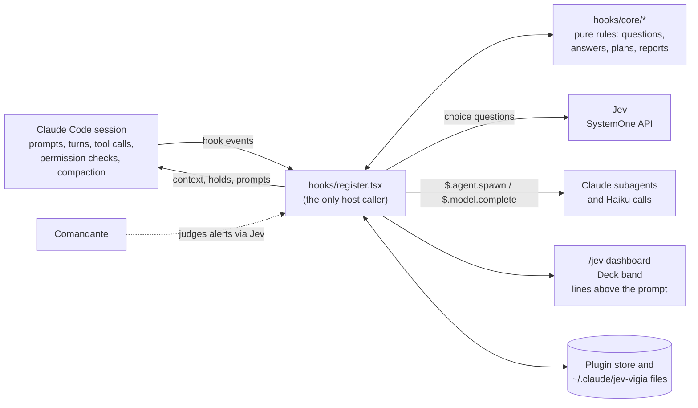

# Pingo: live dashboard and autonomous agents for Claude Code

**Pingo is a Claude Code plugin that shows what a session is doing (requests, tools, subagents, models, tokens) and
adds agents that review code after each change, coordinate parallel sessions, compact long context and rewrite
prompts, plus opt-in ones that hold `git commit`/`git push` until checks pass or keep Claude working toward a goal.
Small semantic decisions go to [Jev](docs/agents/jev.md), TypeSafe's structured decision model; the code work stays
with Claude.**

## What Pingo does

- **Shows the session.** A `/jev` dashboard with 14 screens (live log, execution flow, models and effort actually
  used, subagents, Jev calls, token usage) and the **Deck**, a status band above the prompt with plan, context and
  rate-limit meters and a mascot for everyone at work.
- **Reviews and checks the work.** [Code Quality](docs/agents/code-quality.md) reviews and fixes each change
  unattended. [Portão](docs/agents/portao.md) gates commits and pushes behind review, tests and a security check.
  [Ensaio](docs/agents/ensaio.md) runs the app after a visible change. [Clareza](docs/features/clareza.md) checks
  that answers are clear.
- **Keeps Claude on course.** [Rumo](docs/agents/rumo.md) keeps Claude working until a stated condition holds.
  [Farol](docs/features/farol.md) collects assumptions you can correct. [Semente](docs/features/semente.md) shelves
  side ideas. [Prisma](docs/features/prisma.md) turns design questions into visual choices.
- **Coordinates sessions.** [Vigia](docs/agents/vigia.md) lets sessions of one project see each other, message each
  other and avoid overwriting each other's edits. [Sentinela](docs/features/sentinela.md) lists sessions across
  projects. [Comandante](docs/agents/comandante.md) asks Jev to judge every alert before it takes effect.
- **Maintains the setup.** [Context](docs/core/context-compaction.md) trims old tool results when the context fills.
  [Chaveiro](docs/agents/chaveiro.md) proposes permission rules for calls you keep approving.
  [Oficina](docs/agents/oficina.md) runs `claude doctor` after an update. [Lapida](docs/agents/lapida.md) rewrites a
  draft prompt; [Resumo](docs/agents/resumo.md) writes the session goal.
- **Plans and orchestrates.** [Advisor guidance](docs/core/orchestration.md#advisor-guidance) adds optional planning
  advice from a stronger Claude model to complex prompts. Opt-in: [agent planning](docs/core/agent-planning.md) picks
  model and effort for subagents; [orchestration](docs/core/orchestration.md) runs objectives and managed batches with
  independent review.
- **Searches by meaning.** The [Sift](docs/features/sift.md) CLI and skill filter, classify and rank bounded
  candidates with Jev.

Claude Code keeps control of the main model, tools, permissions and completion. Pingo observes, adds context and
offers actions. Code Quality edits pending files on its own, within code-enforced limits; every other action taken
for you (a rewrite or fix request, a re-run of a held commit, a permission rule) waits for your **Send**, unless you
turned the [Comandante](docs/agents/comandante.md) on for that source. Chaveiro's rules and Portão's passed runs
always wait for you. Every Jev-backed feature **fails open**: with no key, a timeout, or a low-confidence answer, the
session goes on as if the feature were off.


## Agents and tools

| Name | What it does | When it acts | Runs on | Default |
| --- | --- | --- | --- | --- |
| [Jev](docs/agents/jev.md) | Answers structured choice questions for the other features | Whenever a feature needs a semantic judgment | External SystemOne API | Needs a provider key |
| [Comandante](docs/agents/comandante.md) | Approves, rejects or questions each alert from nine features, logged across sessions | When an alert is raised | Jev | Off |
| [Code Quality](docs/agents/code-quality.md) | Reviews pending changes against project patterns and fixes what it can | After each turn that edited files | Claude subagent (+ up to 6 helpers) | On |
| [Vigia](docs/agents/vigia.md) | Shares what other sessions of the project do, carries messages, holds clashing edits | Every prompt, edit and turn | Claude Haiku (turn summary only) | On |
| [Portão](docs/agents/portao.md) | Holds `git commit`/`git push` until review, tests and a security check pass and you approve | When Claude runs a commit or push | Jev + Claude subagent | Off |
| [Rumo](docs/agents/rumo.md) | Turns "until the tests pass" into a goal and keeps Claude working until it holds | A request that states a completion condition | Jev | Off |
| [Ensaio](docs/agents/ensaio.md) | Builds and runs the app after a visible change and reports problems | After a Code Quality cycle (or, with Code Quality off, a turn that edited files) | Jev + Claude subagent | Off |
| [Chaveiro](docs/agents/chaveiro.md) | Proposes the narrowest permission rule for a read-only call you keep approving | Third approval of the same kind of call | Jev | Off |
| [Oficina](docs/agents/oficina.md) | Runs `claude doctor` and suggests `/doctor` when it finds something | Session start on a new Claude Code version or with a full context | Jev | Off |
| [Lapida](docs/agents/lapida.md) | Rewrites your draft prompt with project context and learns from your edits | **Enhance** or `/lapida` | Claude subagent | On |
| [Resumo](docs/agents/resumo.md) | Writes the session goal into Pingo's balloon on the Deck | Each request, while the Deck is on screen | Claude subagent | On (with the Deck pet) |
| [Farol](docs/features/farol.md) | Records Claude's assumptions; your corrections become project rules | When Claude assumes something | No model | On |
| [Clareza](docs/features/clareza.md) | Keeps replies at your level; proposes a rewrite of a confusing answer | Every prompt and turn end | Claude Haiku | On |
| [Semente](docs/features/semente.md) | Shelves side ideas and offers them when recent work matches | Shelving, and turn end | No model | On |
| [Prisma](docs/features/prisma.md) | Shows design questions with SVG previews as a visual picker; remembers choices | `AskUserQuestion` with SVG previews | No model | On |
| [Sentinela](docs/features/sentinela.md) | Lists sessions across projects, resumes them, replies to waiting ones | Continuously (refresh every 2 s) | No model | On |
| [Context](docs/core/context-compaction.md) | Asks Jev which old tool results to drop instead of summarizing | Context ≥ 60% or a compaction | Jev | On |
| [Agent planning](docs/core/agent-planning.md) | Picks model and effort for a subagent Claude starts | Subagent spawn | Jev | Off |
| [Orchestration](docs/core/orchestration.md) | Objectives, executor profile, managed batches with independent review | Each human prompt, when enabled | Jev + Claude | Off |
| [Advisor guidance](docs/core/orchestration.md#advisor-guidance) | Adds optional planning advice from a stronger Claude model | A prompt that scores as complex, up to 3 per session | Claude (a local rule decides) | On while routing is on |
| [Deck and Pingo Vivo](docs/features/deck.md) | Status band and animated mascots | Always | No model | On |
| [Sift](docs/features/sift.md) | Semantic filter, classify, rank and find over bounded inputs | When Claude or you run it | Jev | Available |

"Claude subagent" means a background agent Pingo registers as `jev:<name>`, hidden from Claude's own agent list.

## How the core works

`hooks/register.tsx` is the only module that talks to Claude Code: it subscribes to the session's events and holds
every host call. The modules in `hooks/core/` are pure: they build Jev questions, read the answers, validate plans
and reports, and hold the permission rules for Pingo's own agents. Details: [docs/core/architecture.md](docs/core/architecture.md).



## Quick start

Requires **Claude Code 2.1.292 or newer** with mod support. Sift requires **Node 22.18 or newer**; Prisma's browser
picker needs Python. Everything that does not ask Jev works without a key: the dashboard, the Deck, Code Quality,
Lapida, Resumo, Clareza, Vigia, Farol, Semente, Prisma and Sentinela. Jev-backed features need a provider key.

```sh
git clone https://github.com/petersonPaloschi/pingo-claude-code.git pingo
cd pingo
claude --plugin-dir .
```

1. Run `/jev setup` to pick a provider on the AI screen, paste its key in the masked field, and press **Test and
   save**. A refused key is not saved.
2. Run `/jev status` to check the provider, the key's source and the observed execution.
3. Run `/jev` to open the dashboard. Turn optional features on from the AI and Features screens, or with
   `/jev feature <id> on`.

For later sessions, keep `--plugin-dir` or add the absolute directory to `~/.claude/settings.json`:

```json
{ "env": { "CLAUDE_CODE_PLUGIN_DIRS": "/absolute/path/to/pingo" } }
```

On Windows, use a path such as `C:/Projects/pingo`; separate several directories with semicolons. The plugin
identifier is **`jev`**: commands start with **`/jev`** and environment variables with **`JEV_*`**.

## Dashboard

`/jev` opens 14 screens in three folders on a left rail. Each screen has a key.

| Folder | Screen (key) | What it shows |
| --- | --- | --- |
| Session | Overview (1) | Session state, request outcomes, failures, timing, usage and Jev calls for a time range. |
| | Live (2) | What happens now: main model and effort, active workers, tool activity, messages, results; the latest Jev call pinned on top. |
| | Models (3) | Requested versus observed model and effort, duration, and reported input/output/cache tokens. |
| Work | Agents (4) | Running and finished subagents with task, activity, model, effort and tokens; a live pane per agent. |
| | Logs (5) | Routing reasons, recent requests and every AI call with its answer or failure. |
| | Flow (0) | One request from prompt to result, step by step. |
| | Orchestration (o) | The orchestration policy, current objective and managed batches. |
| | Quality (q) | Code Quality cycles: what was reviewed, fixed and left. |
| | Comandante (d) | Every ruling in every session of the project, with filters and per-source switches. |
| | Autonomous (a) | Portão, Rumo, Ensaio, Chaveiro and Oficina runs with their **Enviar**, **Rejeitar**, **Liberar** and **Parar** buttons. |
| Settings | Configuration (6) | Interface language and history. |
| | Deck (7) | What the status band shows and how. |
| | Features (8) | Pingo Vivo and Sentinela switches; completion sound, mascot hat and shades, Sentinela's refresh and Vigia's clash window. |
| | AI (9) | Jev provider, key, connection test, routing, and the AI feature switches and preferences. |

The interface is available in English and Brazilian Portuguese. Some buttons on the Autonomous screen keep their
Portuguese labels in both languages.

## Commands

| Command | Action |
| --- | --- |
| `/jev [overview\|live\|models\|agents\|logs\|flow\|quality\|comandante\|autonomous\|configuration\|deck\|ai]` | Open a screen (aliases: `dashboard`, `fluxo`, `qualidade`, `commander`, `autônomos`, `portao`, `rumo`, `ensaio`, `chaveiro`, `oficina`, `ia`, `setup`). |
| `/jev agent [n\|type\|name] [remove]`, `/jev agents clear` | Open a worker's pane, remove a finished run, or clear finished runs. |
| `/jev setup [provider]` | Open the AI screen with a provider selected. |
| `/jev status` | Show settings and observed execution. |
| `/jev routing on\|off` | Turn Jev routing (orchestration, agent planning and advisor guidance) on or off. |
| `/jev feature <id> on\|off` | Turn a feature on or off (`agents`, `farol`, `clareza`, `pingoVivo`, `prisma`, `semente`, `lapida`, `sentinela`, `vigia`, `contexto`, `codeQuality`, `comandante`, `portao`, `ensaio`, `rumo`, `chaveiro`, `oficina`). |
| `/jev orch [setting]` | Open orchestration, or change its policy ([commands](docs/core/orchestration.md#commands)). |
| `/jev clear` | Clear completed history; active work stays. |
| `/comandante` | Open the Comandante's rulings. |
| `/vigia [msg <session\|all> <text>]` | Show the project's other sessions, or message them. |
| `/sentinela` | Show sessions across projects. |
| `/farol`, `/semente [idea]`, `/clareza [...]`, `/lapida <draft>`, `/prisma-decisions [clear]` | Feature commands (see each doc). |
| `/deck [...]`, `/pingo [...]` | Control the status band and the mascot ([Deck](docs/features/deck.md)). |

## Providers and configuration

Jev is reached through one of four providers. Availability and prices are set by the provider.

| Provider ID | Key environment variable | Default Jev model |
| --- | --- | --- |
| `typesafe` | `TYPESAFE_API_KEY` | `jev-latest` |
| `openrouter` | `OPENROUTER_API_KEY` | `typesafe/jev-1.13` |
| `vercel` | `AI_GATEWAY_API_KEY` | `typesafe-ai/jev` |
| `opencode` | `OPENCODE_API_KEY` | `jev-1.13-free` |

Configure on the AI screen or with `/plugin configure jev@inline`:

| Option | Default | Purpose |
| --- | --- | --- |
| `provider` | `auto` | Select a provider. `auto` uses `JEV_PROVIDER`, else the first provider key found in the environment, else TypeSafe. |
| `api_key` | Empty | Sensitive credential; empty uses the selected provider's environment key. |
| `model` | Provider default | Jev model ID, separate from Claude's model. |
| `min_confidence` | `0.7` | Below this confidence a Jev answer is ignored; falls back to `JEV_MIN_CONFIDENCE`. |
| `timeout_ms` | `4000` | One Jev call, retry included; falls back to `JEV_TIMEOUT_MS`; held between 500 and 30000 ms. |
| `locale` | `auto` | Interface language: `auto`, `en` or `pt`. |
| `routing_locale` | `en` | Language of Jev's questions; conversation content is kept as is. |
| `claude_models` | Built-in list | Claude model IDs offered to agent planning. |
| `context_*` | See [Context](docs/core/context-compaction.md#configuration) | Compaction threshold, minimum reduction, keep threshold and limits. |

**Test and save** validates a pasted key with one real call before saving the provider/key pair in the local plugin
store (`~/.claude/plugins/store`) and attempting Claude Code's sensitive `api_key` option. **Remove key** clears the
local copy and attempts to clear the sensitive option; a key in the environment stays in use. The field is masked and shows only the last four characters. Keep keys out of
command arguments, repository files and screenshots.

## Data handling

- **Sent to Jev:** the feature's question and its bounded state. Examples: Context sends fitted conversation text and
  abbreviated tool inputs (results replaced by size notes); agent planning sends the agent type and a bounded task;
  Portão sends the command, changed file names and test names; the Comandante sends the alert and your latest request
  (clipped). Sift sends the content you select. Limits do not redact secrets inside normal content.
- **Sent to Claude:** Clareza's answer review and Vigia's turn summary go to Haiku; advisor guidance and
  orchestration reviews go to the chosen advisor or reviewer model; Pingo's subagents run like any subagent.
- **Kept locally:** the latest 500 request records (metadata, no prompt or tool bodies); per-project Farol rules,
  Semente ideas, Prisma decisions and Lapida taste in the plugin store; Vigia session records and Comandante rulings
  under `~/.claude/jev-vigia/<project>/`. The live feed and Flow can include shortened prompts, paths and errors. A
  failure cause can keep a short provider excerpt, with the configured key redacted.
- **Written to your settings:** only by [Chaveiro](docs/agents/chaveiro.md), and only after you press **Enviar**.

Sift refuses credential-like files, binaries, files over 2 MB, lockfiles and dependency folders, and saves results
only with `--save`.

## Validation

```sh
claude plugin validate .
node scripts/test.ts                    # the plugin tests, a few files at a time
npx --yes --package typescript tsc --noEmit
node --test tests/sift-cli.test.mjs
```

The suites use stubbed providers and isolated configuration. They verify behavior, not live Claude or Jev quality,
speed or cost. The [evaluation protocol](bench/protocol.md) and the [pilot summary](docs/evaluation/results/matched-pilot-summary.md)
describe what was measured and its limits. See [CONTRIBUTING.md](CONTRIBUTING.md) and [SECURITY.md](SECURITY.md).

## Documentation

All docs are indexed in [docs/README.md](docs/README.md): the [core architecture](docs/core/architecture.md), one page
per agent and feature, the [orchestration plan](docs/jev-orchestration-plan.md), the [visual design](DESIGN.md) and
the [style system](docs/style-system.md).

## License

[MIT](LICENSE).
