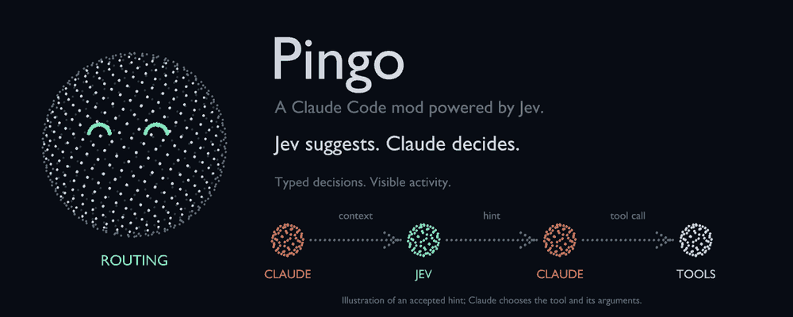

# Pingo

**A Claude Code mod powered by Jev.**

Pingo adds tool suggestions, optional model and subagent planning, and a live dashboard to Claude Code. It asks [TypeSafe's Jev](https://typesafe.ai/) for structured decisions, checks the answers, and feeds accepted tool suggestions back to Claude.

**Jev suggests. Claude decides.** Claude still writes the answer, chooses tool arguments, and executes tools through Claude Code.



The project is called **Pingo**. The current plugin identifier is **`jev`**, its commands start with **`/jev`**, and its configuration uses **`JEV_*`** environment variables. Use those names with this version.

[Quick start](#quick-start) · [How it works](#how-it-works) · [Features](#features) · [Commands](#commands) · [Data handling](#data-handling)

## What Pingo adds

| Component | Role |
| --- | --- |
| **Claude Code** | Runs the coding session, manages tools and permissions, and produces responses. |
| **Jev** | Answers structured decision questions with choices, confidence, and numerical scores. |
| **Pingo** | Connects Jev to Claude Code, validates decisions, applies enabled planning features, and shows observable activity. |

With ordinary Claude Code, Claude selects its next action from the conversation and available tools. With Pingo's default settings, Jev also evaluates the next tool and Claude receives a suggestion when the answer passes the routing checks. The dashboard, activity feed, and subagent views show those decisions and the session's work.

Optional features can change the model or effort used for a turn or a subagent. They are **off by default**. Tool and delegation suggestions are advisory; model and effort selections, when enabled and applicable, are applied to requests.

Routing adds provider calls, latency, and any charges from that provider. This repository does not establish a guaranteed improvement in speed, cost, or task quality. The Baseline tab compares recorded request counts, token usage, cache share, and request duration with routing on and off; it is not a controlled benchmark.

## Quick start

Requires **Claude Code 2.1.292 or newer** with mod support and a Jev credential from a supported provider.

```sh
git clone https://github.com/petersonPaloschi/jev-claude-code.git pingo
cd pingo
claude --plugin-dir .
```

Inside Claude Code:

1. Run `/jev setup` and choose your provider.
2. Paste its key into the masked **API key** field, then press Enter or **Test and save**. A refused key is neither saved nor used.
3. Run `/jev status` to check the provider, credential source, and enabled features. Run `/jev` to open the dashboard.

Read [Data handling](#data-handling) before enabling routing on private work: Jev receives recent conversation and tool data.

For future sessions, use the same `--plugin-dir` argument, or add an absolute directory to `~/.claude/settings.json`:

```json
{
  "env": {
    "CLAUDE_CODE_PLUGIN_DIRS": "/absolute/path/to/pingo"
  }
}
```

On Windows, use a path such as `C:/Projects/pingo`; separate multiple plugin directories with semicolons.

## How it works


*The README animations were created with Higgsfield 3D Jutsu. They illustrate the mascot and an accepted hint, rather than recording the dashboard or measuring performance.*

1. **Collect context.** At the start of a new turn, Pingo reads the composed system instructions, recent conversation, and available tool roster. The current request and latest tool result are also named explicitly. Observed model, context-token and cache-token counts accompany configured model candidates. A message submitted during a running turn keeps that turn's existing plan.
2. **Ask Jev.** The tool questions ask which tool fits next and whether a tool is needed. Enabled turn-planning questions travel in the same request. A roster over 120 tools adds a shortlisting call before the final choice.
3. **Check the answer.** A tool hint must meet the confidence threshold, pass the tool-needed consistency check, name an offered tool, and target a tool the router can hint. Choice answers need explicit confidence and a valid probability distribution; the router never substitutes winning probability for confidence. Unknown choices, unsupported hosted-tool selections, and malformed answers fall through. Large rosters keep top candidates within each group, without comparing probabilities from different groups as if they shared a distribution.
4. **Give Claude a hint.** An accepted tool choice is added to Claude's context. Enabled delegation and advisor recommendations can join the same note. Claude supplies tool arguments and decides whether to follow the suggestions.
5. **Repeat after tools.** With Tool hints enabled, Pingo consults Jev after the last result in a main-session tool batch. It does not route another plugin's own tool calls or each tool call inside a subagent.
6. **Record activity.** The dashboard shows routing reasons, confidence, latency, token usage, visible replies, tools, and subagent activity. Flow records each run from its submitted message to its answer, including activity observed while Jev routing is off.

Low confidence, disagreement, an unavailable provider, a timeout, or an unreadable reply leaves Claude to continue without a tool hint. This is the mod's **fail-open** behavior.

`/jev routing off` disables every Jev consultation and switches to baseline mode. The dashboard remains available. With every feature disabled, Jev is also not called.

## Features

Change features in `/jev features` or with `/jev feature <id> on|off`.

| ID | Default | Behavior |
| --- | --- | --- |
| `tools` | On | Suggest the next tool when routing checks pass. |
| `participation` | Off | Let Jev decline tool, delegation, and advisor hints for a turn. Model and effort planning can still apply. |
| `model` | Off | Select Haiku, Sonnet, or Opus for the main turn, subject to the model safeguards below. |
| `effort` | Off | Select an effort level where the target model and request support it. |
| `delegation` | Off | Suggest an offered subagent type. Claude decides whether to start it. |
| `agents` | Off | Plan model and effort for eligible subagents when Claude starts them. |
| `advisor` | Off | Ask Jev whether planning, ambiguity, a recurring failure, or an independent check warrants consulting the advisor. A confident recommendation adds a hint; Claude decides whether to call it. |

For example, enable main-turn model planning with:

```text
/jev feature model on
```

To request advisor recommendations and inspect their observed results:

```text
/jev feature advisor on
/jev models
/jev flow
```

The advisor question joins the prompt's existing Jev routing request. If every other feature is off, enabling it adds one Jev request per new prompt. A `consult` recommendation must meet the configured minimum confidence; a missing answer, low confidence, or a failed Jev call adds no advisor hint. When participation is enabled, Jev must also answer that question and choose to take part. Messages submitted during a running turn keep that turn's plan.

This feature asks Claude to use its available advisor tool. It does not configure, enable, or change the advisor model. In Models, **applied** means the suggestion was attached to the prompt; an actual advisor call is recorded separately from the model response.

A model explicitly selected by the user is preserved until they return to the default. Provider-specific model IDs and extended-context models are also preserved. Subagent planning skips workflow-managed agents, forks, and agents with an explicitly requested model. Haiku does not receive an effort setting.

Model criteria describe both appropriate work and tasks to avoid. The main-turn question offers exact configured model IDs plus a choice to keep the current model. A rejected or missing recommendation retains the last successful model. With minimum confidence `c`, upgrades require `c`, downgrades require `c + (1-c)/2`, and downgrades with observed warm cache halve the remaining tolerated uncertainty again. At the default `0.7`, those thresholds are `0.7`, `0.85`, and `0.925`. This is a conservative policy, not a measured estimate of cache savings or task accuracy.

Two consecutive empty responses from a switched model exclude that candidate for the session; other candidates remain eligible. Interrupts do not count. The live feed records why a recommendation was retained or rejected. Subagents continue to use the native tier aliases and omit tiers with no remaining configured candidates.

### Sift: bulk judgments

The plugin also ships the **`sift`** skill. When Claude is about to read many files, a long log, or a large list only to decide which parts matter, it can run `scripts/sift.ts` instead. Jev answers one yes/no or pick-a-label question per item, in parallel, and Claude reads back a compact shortlist with uncertain items marked `?`.

| Command | Use |
| --- | --- |
| `sift filter "<yes/no question>" <inputs>` | Keep the files, lines (`--lines`), or JSONL items (`--items`) where the answer is yes. Repeated log lines are folded into one pattern. |
| `sift classify --labels "a,b,c" <inputs>` | Put each item in one bucket, listing low-confidence items with their runner-up label. |
| `sift rank "<query>" <inputs>` | Order items by relevance to a query. |
| `sift find "<what>" <files>` | Locate the matching lines inside large files. |
| `sift ask "<question>" --state @file` | One yes/no or `--choice` answer over a document, or a raw `{state, questions}` spec. |
| `sift status` | Check the provider, key source, and model with one real call, and show the lifetime totals: runs, items judged, Jev tokens, and Claude tokens not read. |

Sift uses the same provider, key, and model as routing: the key saved by `/jev setup`, the plugin options, then the provider environment variables. It runs outside the mod with Node 22.18 or newer, does not depend on the routing switch or features, and does not appear in the dashboard beyond its Bash call. Results are a shortlist, not proof: Claude is told to open the survivors and read the `?` items itself. Sift adapts [Quicksilver](https://github.com/UditAkhourii/quicksilver)'s approach to Pingo's providers and credentials. Its twelve-situation benchmark, which scores sift against a recorded Claude-alone baseline, lives in [`bench/`](bench/README.md).

## Dashboard and visual language

Pingo is a dotted sphere with six expressions. The same projected geometry is rendered as **braille cells in the terminal** and **SVG circles on the desktop**. Color indicates state; exact confidence, latency, and usage remain readable as text.

| State | Meaning |
| --- | --- |
| Routing | Jev's tool suggestion passed the routing checks. |
| Thinking | A Jev request is in flight; the eyes spin and an orbit ring appears. |
| Passthrough | No tool hint was applied; Claude continues on its own. |
| Failing | A routing request failed or returned an unusable response. |
| Idle | No recent routing activity. |
| Baseline | Routing is switched off. |

**Overview** shows usage and routing totals. **Live** shows visible session events. **Models** shows model switches, decisions for each enabled function, and the confidence the next model change needs. It also compares runs with and without an advisor hint: observed consultations, average duration, reported tokens, and completion. These observations do not measure answer quality or establish that the hint caused an improvement.

**Agents** lists subagent state, model, effort, and activity. Each agent has a numbered live pane and a distinct dotted mascot. **Features**, **Reasons**, **Baseline**, **Logs**, and **Setup** expose controls and recorded metadata.

**Flow** draws the submitted message, Jev consultations, the main loop's original, sent and answering models, tools grouped by source (built-in, MCP, API-run), subagents, advisor calls, and the answer with its edits. Earlier runs appear below. A message typed into a running turn appears with its association pending. An empty record shows an empty state instead of a sample diagram.

Flow keeps the last 40 completed runs and every run with a main turn or subagent still active. Its text diagram adapts to the pane width. While Flow is visible and work is active, a pulse refreshes at up to 10 frames per second, with one redraw pending at a time. `/jev status` reports the latest run and measured redraw cost.

### Observation limits

Advisor calls become observable only when the model request's response arrives. The SDK exposes neither the advisor's model nor its token usage. A received result does not indicate whether the consultation succeeded. The advisor comparison includes only runs whose prompt asked the advisor question; duration covers the main turn, and token counts include reported main-loop and subagent usage, including cache reads and writes.

The current implementation has three known limitations:

- Remote workflow agents emit no local completion event, so their Flow entries can remain active after the main turn ends. Those runs remain outside the completed-run limit and survive `/jev clear`.
- The advisor comparison includes a run as soon as its main turn ends, even if background subagents are still working. Its observed calls and token totals can therefore change afterward.
- Branch ordering uses the retained call details. Once a run exceeds 30 tool calls or 24 advisor calls, discarded early timestamps can change the displayed order of branches.

The dashboard, commands, activity feed, and hints support English and Brazilian Portuguese. Set **Language** to `en`, `pt`, or `auto` in `/jev setup`. `auto` follows the system locale. Jev's decision questions and criteria default to English independently; set the `routing_locale` plugin option to `pt` for Portuguese. Conversation content is never translated.

See [DESIGN.md](DESIGN.md) for the visual system and [media notes](docs/media/README.md) for the README animations.

## Providers and configuration

These are the adapters and default model IDs configured in the code:

| Provider ID | Provider | Key environment variable | Default Jev model |
| --- | --- | --- | --- |
| `typesafe` | [TypeSafe](https://typesafe.ai/) | `TYPESAFE_API_KEY` | `jev-latest` |
| `openrouter` | [OpenRouter](https://openrouter.ai/blog/tutorials/how-to-use-jev/) | `OPENROUTER_API_KEY` | `typesafe/jev-1.13` |
| `vercel` | [Vercel AI Gateway](https://vercel.com/ai-gateway/models/jev) | `AI_GATEWAY_API_KEY` | `typesafe-ai/jev` |
| `opencode` | [OpenCode Zen](https://opencode.ai/docs/en/zen/) | `OPENCODE_API_KEY` | `jev-1.13-free` |

Model availability is controlled by the provider. The OpenCode adapter also accepts `jev-1.13`; its setup check suggests that paid model if the free endpoint becomes unavailable.

Configure options through Setup or `/plugin configure jev@inline` when loaded with `--plugin-dir`:

| Option | Default | Purpose |
| --- | --- | --- |
| `provider` | `auto` | Choose `typesafe`, `openrouter`, `vercel`, or `opencode`. |
| `api_key` | Empty | Sensitive credential. Setup also retains a local key/provider pair; otherwise use the chosen provider's environment variable. |
| `model` | Provider default | The **Jev** model ID, separate from the Claude model selected by turn planning. |
| `min_confidence` | `0.7` | Minimum confidence for choice answers; accepts 0–1. Falls back to `JEV_MIN_CONFIDENCE` when unset or invalid. |
| `timeout_ms` | `4000` | Budget for one Jev call, including its retry. Falls back to `JEV_TIMEOUT_MS` when unset; clamped to 500–30000 ms. |
| `locale` | `auto` | Interface, commands and hint language: `auto`, `en`, or `pt`. |
| `routing_locale` | `en` | Language of Jev decision questions and criteria: `en` or `pt`. |
| `claude_models` | Built-in Haiku, Sonnet and Opus IDs | Comma-separated first-party model IDs supported by your account. Versions are separate choices. Empty uses built-ins; invalid IDs are ignored, duplicates removed, and at most 40 candidates retained. |

`claude_models` is an explicit candidate list, not automatic account discovery. Configure it through `/plugin configure jev@inline`, for example `claude-sonnet-4-6,claude-sonnet-5-5,claude-opus-5-5`. The existing safeguards preserve provider-specific and extended-context model selections.

A retryable HTTP status or network failure gets one retry inside the call's time budget. A timeout or unreadable response does not get another attempt. Large tool rosters can require two separate calls, each with its own budget.

<details>
<summary>Credential selection and storage</summary>

When no Setup credential overrides the session, the explicit `provider` option takes precedence over `JEV_PROVIDER`. Under `auto`, Pingo uses the first provider with a key in the environment, in the table's order, or TypeSafe if none is set. A credential restored from the local store stays paired with its saved provider.

Set the provider to match the issuer of `api_key`. Pingo cannot infer the issuer from the key. With neither an explicit provider nor `JEV_PROVIDER`, the sensitive option is treated as a TypeSafe key. A provider auto-detected from its environment variable gets that variable's key, never a key saved for a different provider.

Setup tests a pasted key, saves the accepted key/provider pair in the local plugin store under `~/.claude/plugins/store`, and also attempts to save Claude Code's sensitive `api_key` option using `claude plugin configure --values-stdin`. The local copy restores the key in future sessions when the sensitive option is absent. Treat plugin-store files as sensitive credential files. The setup field is masked and shows only the last four characters after saving; `/jev status` reports the source without revealing the key. **Remove key** clears the local copy and attempts to clear the saved option; a refusal from the configuration runtime is reported.

If the runtime cannot save the sensitive option, the local plugin-store copy still persists the credential and its provider. If both saving paths fail, Setup reports the failure and restores the previous provider configuration. A separate provider fallback is retained when the provider option cannot be saved.

**Test connection** sends a saved key only to its configured provider. Testing another provider uses that provider's environment key or asks for a new pasted key.

Older versions stored a plain-text key in plugin state. Current startup removes that legacy value; configure a replacement through the sensitive option or an environment variable.

Do not put keys in slash-command arguments, repository files, screenshots, or issue reports.

</details>

## Commands

| Command | Action |
| --- | --- |
| `/jev`, `/jev dashboard`, `/jev overview` | Open Overview. |
| `/jev live` | Open the live activity feed. |
| `/jev models` | Open the Models tab: model switches, why they did or did not happen, and what the next one needs. |
| `/jev agents` | List subagents and their activity. |
| `/jev agent` | Open the newest running subagent, or the latest retained run. |
| `/jev agent <number, type, or mascot>` | Open a particular subagent's live pane, e.g. `/jev agent 3`. |
| `/jev agent <number, type, or mascot> remove` | Remove a finished run and close its pane. |
| `/jev agents clear` | Remove all finished runs; running agents stay. |
| `/jev flow` | Open the run diagram: message, Jev, models, tools, subagents, advisor calls, answer. |
| `/jev features` | View and toggle the seven routing features. |
| `/jev reasons` | Show why hints were not applied. |
| `/jev baseline` | Compare recorded request metrics with routing on and off. |
| `/jev logs`, `/jev log` | Browse request metadata. |
| `/jev setup [provider]` | Configure and test a provider; enter the key in the masked field. |
| `/jev status` | Show routing settings, features, credential source, the latest Flow run, and measured Flow redraw cost. |
| `/jev routing on`, `/jev routing off` | Enable Jev consultations or switch to baseline. |
| `/jev feature <id> on`, `/jev feature <id> off` | Toggle a feature independently. |
| `/jev clear` | Clear request history, the live log, model decision history, finished subagents, and completed Flow runs; active runs stay. |

Arguments are case-insensitive. Agent numbers are not reused within a session. The dashboard routing button and `r` shortcut also switch routing on and off.

## Data handling

When routing is enabled, a key is configured, and an applicable feature is on, Pingo sends requests over HTTPS to the **selected Jev provider**. That provider receives:

- Composed Claude Code system instructions, truncated to 4,000 characters.
- Recent prompts, visible replies, tool-call arguments, and tool results. Results can include source files, command output, web pages, and MCP responses. Each text or argument/result entry is truncated to 4,000 characters, retaining its head and tail; recent turns are kept within an approximate 60,000-character state budget.
- Available tool names and bounded descriptions, or parameter names when descriptions are absent. Large rosters are shortlisted before the final question.
- Enabled planning questions. Eligible subagent-planning calls instead contain the agent type, a task description capped at 400 characters, and a task prompt capped at 4,000 characters.
- Configured model IDs and observed execution metadata: current model, context tokens and cache-read tokens. These counts describe the latest observed request, not the exact size of the next one.

Truncation limits request size; it **does not redact secrets** from conversation or tool content. Only use routing for information you are allowed to share with that provider. `/jev routing off` stops every routing request.

When Claude runs the `sift` skill, the selected provider receives the content of each judged item (a file, line, or JSONL entry, cut at 60,000 characters by default) together with Claude's question, labels, or query. `/jev routing off` does not affect sift. It skips files that look like credentials (`.env*`, keys, certificates, `credentials`/`secrets` files), binaries, files over 2 MB, lockfiles, and paths ignored by git, but it does not redact secrets inside other files. Sift stores nothing; `--save FILE` writes results only where asked.

Pingo's views show observable activity and visible response text. They do not expose the models' private internal reasoning. The live feed stays in session memory; it may contain shortened prompts, tool details, response text, and provider errors.

The latest **500 request records** are persisted in the plugin store under the Claude Code configuration directory. Records contain timestamps, a short session ID, model names, routing reason codes, tool counts, Jev choices and confidence, applied changes, latency, and token usage. Conversation prompts and tool arguments/results are not stored as record fields. Failed or unusable Jev replies also retain an observed cause capped at 240 characters; this can include a provider-error excerpt or discarded-answer details. The provider layer redacts the configured API key from error messages. The Models tab keeps up to 40 routing points in session memory, including failed consultation attempts and the accepted results of independent questions.

Flow keeps a separate session-state record under `flowV2`, which survives plugin reloads in that session. It includes message excerpts capped at 200 characters, model IDs, tool names and sources, subagent summaries, advisor-call timestamps, edit paths, and reported token totals. Detailed call lists are bounded separately from aggregate tool and Jev counts. The previous Flow schema is not migrated into this record. Clearing completed Flow runs leaves active work available for later events.

The store also retains the routing and feature switches, a fallback provider selection when needed, and the validated key/provider pair saved in Setup. The credential entry is separate from request records. `/jev clear` empties the request history and session feed; use Setup's **Remove key** action to remove the credential copy.

## Development

```sh
claude plugin validate .
claude plugin test .
```

Tests run in Claude Code's plugin test runtime with stubbed provider responses; they do not need a real API key.

| Source | Responsibility |
| --- | --- |
| [`hooks/register.tsx`](hooks/register.tsx) | Session hooks, commands, model application, state, and UI integration. |
| [`hooks/core/decide.ts`](hooks/core/decide.ts) | Routing checks, shortlisting, and fail-open decisions. |
| [`hooks/core/plan.ts`](hooks/core/plan.ts) | Feature defaults and turn/subagent planning. |
| [`hooks/core/jev.ts`](hooks/core/jev.ts) | Provider adapters, response normalization, retries, and key validation. |
| [`hooks/config.ts`](hooks/config.ts) | Settings, credential selection, thresholds, and request limits. |
| [`hooks/input.ts`](hooks/input.ts), [`hooks/core/state.ts`](hooks/core/state.ts) | Transcript conversion and bounded provider context. |
| [`hooks/ui.tsx`](hooks/ui.tsx), [`hooks/flow.ts`](hooks/flow.ts) | Dashboard and Flow rendering. |
| [`hooks/trace.ts`](hooks/trace.ts) | The Flow tab's run record: pure reducers over the SDK's events. |
| [`hooks/mascots/`](hooks/mascots/) | Pingo, user, and subagent geometry. |
| [`hooks/core/sift.ts`](hooks/core/sift.ts), [`scripts/sift.ts`](scripts/sift.ts), [`skills/sift/`](skills/sift/) | The sift skill: bulk-judgment questions and output (pure), the Node CLI that collects inputs and calls Jev, and Claude's instructions. |

See [CONTRIBUTING.md](CONTRIBUTING.md) for the development workflow and [SECURITY.md](SECURITY.md) for vulnerability reports.

## License

[MIT](LICENSE).
