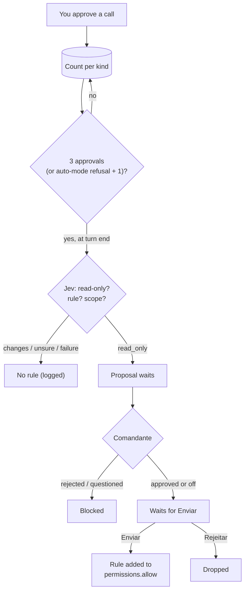

# Chaveiro: permission rules for calls you keep approving

When you approve the same kind of call for the third time, Chaveiro asks Jev whether those calls only read, which is
the narrowest permission rule that covers them, and which settings file should keep it. The rule is written only when
you press **Enviar**.

| | |
| --- | --- |
| Feature id | `chaveiro` |
| Default | **Off** |
| How it runs | One Jev request with three choice questions |
| Command | `/jev chaveiro` opens the Autonomous tab (rail key `a`) |
| Code | `hooks/core/chaveiro.ts`; `chaveiroChecked`, `chaveiroTurnCompleted`, `chaveiroSend` in `hooks/register.tsx` |

## When it acts

1. **Counting.** On each permission check, a call Claude Code would ask you about is remembered. If you approve it and
   it runs, it counts as one approval for its kind. A refused call is not counted. In bypass mode nothing asks, so
   nothing is counted.
2. **Deciding.** At the end of a main turn, when a kind of call has **3 approvals**, or was refused by auto mode and
   has at least one approval, has no rule yet and was not weighed in this session, and no other rule is waiting for
   you (one open rule pauses Chaveiro).

A **kind** is a shell command's first two words (`git status`), a chained shell line as a whole, a `WebFetch` domain,
or an MCP tool name.

## How it works

1. Chaveiro builds the candidate rules, narrowest first. For `git log --oneline -5` they are
   `Bash(git log --oneline -5)`, `Bash(git log:*)` and `Bash(git:*)`. A chained line (`&`, `;`, `|`, a newline,
   `$(…)`, redirects) has only its exact rule, and so does a program that runs or reaches whatever its arguments say
   (`bash`, `env`, `sudo`, `node`, `python`, `npx`, `find`, `sed`, `curl`, `ssh` and similar).
2. Jev answers:
   - `reads`: read_only / changes / unsure. Only a confident **read_only** continues.
   - `rule`: the narrowest candidate that still covers what you approve (the narrowest one when unsure).
   - `scope`: `local` (`.claude/settings.local.json`), `project` (`.claude/settings.json`) or `user`
     (`~/.claude/settings.json`); `local` when unsure.
3. The proposal waits for you. With the [Comandante](comandante.md) on, it is judged first: rejected or questioned
   rules are blocked. **An approved rule still waits for your Enviar.**
4. **Enviar** reads the settings file, adds the rule to `permissions.allow` (keeping every other key, never adding a
   duplicate) and writes it back. If the file is not a JSON object, nothing is written and the rule stays waiting
   ("Chaveiro could not write … Nothing was changed."). **Rejeitar** drops it.

## What you see

- **Above the prompt** (hidden when the Deck lane is on screen, where the mascot says it): "? allow <rule>? ·
  Chaveiro".
- **Autonomous tab:** one card per rule with the rule, the call it covers, how many times you approved it, and where
  it would be written ("this project, this machine only", "this project, for the whole team", "every project of
  yours"), with **Enviar** and **Rejeitar**.

## Configuration

| Setting | Where | Default |
| --- | --- | --- |
| Chaveiro on/off | AI screen, or `/jev feature chaveiro on\|off` | Off |

The last 20 rules are kept; five sample calls per kind. A failed Jev call is logged the same way as "not read-only"
("Jev did not judge … read-only; no rule"), and that kind is not weighed again in this session.

## To confirm

- Calls made by subagents appear to count as approvals too (the counter does not filter by agent).
- Whether writing creates a missing `.claude/` folder.
