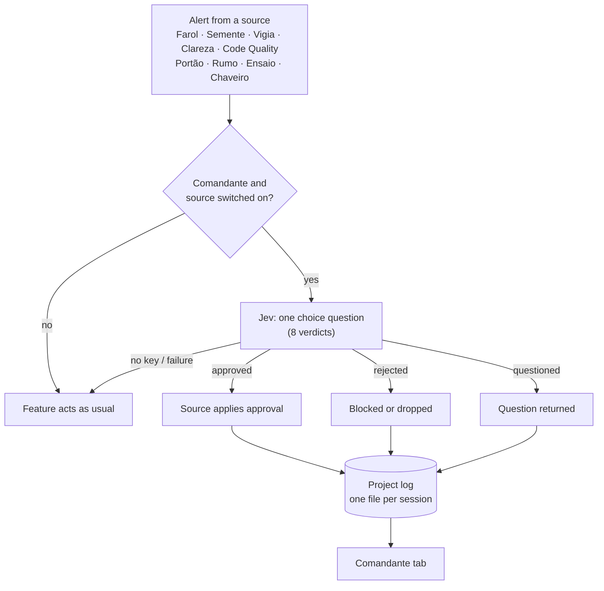

# Comandante: Jev judges every alert

The Comandante asks Jev to judge each alert that another Pingo feature raises, in every session of the project, before
it takes effect. Jev approves what holds, rejects what should not stand, and questions what needs clarifying. Every
ruling is logged with its reason on the Comandante tab.

| | |
| --- | --- |
| Feature id | `comandante` |
| Default | **Off** |
| How it runs | One Jev choice question per alert. Needs a Jev key; without one, or when Jev fails, everything proceeds as if the Comandante were off. |
| Command | `/comandante`, `/jev comandante`, `/jev commander` open its tab (rail key `d`) |
| Code | `hooks/core/comandante.ts`; `comandanteReview`, `comandanteCatchUp` in `hooks/register.tsx` |

## When it acts

- **On arrival:** when a source raises an alert (Claude records an assumption, shelves an idea, a Vigia message
  arrives, Clareza writes a plan, and so on).
- **Catch-up:** items still waiting are judged on events, never on a clock: at session start, when a feature or a
  source is switched on, when you save an idea, on a project change, and on `/clear`, `/resume` and fork. Each item is
  tried once.

## Sources

Nine sources, each with its own switch on the tab (all on by default): Farol, Semente, Vigia, Clareza, Code Quality,
Portão, Rumo, Ensaio and Chaveiro.

| Source | What is judged | Approved | Rejected | Questioned |
| --- | --- | --- | --- | --- |
| [Farol](../features/farol.md) | An assumption Claude records | Recorded as right | Tool call refused | Question back to Claude, nothing recorded |
| [Semente](../features/semente.md) | An idea Claude shelves; a saved idea about to be offered | Saved / offered | Not saved / not offered | Not saved / offered with the question |
| [Vigia](vigia.md) | A message from another session (not clash notices) | Delivered | Held; you can **Release** it from the Vigia pane | Delivered with the question |
| [Clareza](../features/clareza.md) | A rewrite plan | Sent to Claude for you (waits if a turn runs) | Plan dropped | Shown with **Send** / **Reject** |
| [Code Quality](code-quality.md) | A call the agent would need to ask for | **Still refused**: the agent never passes its limits | Refused | Refused |
| [Portão](portao.md) | A failed check run | Failures sent to Claude; the commit stays held | Blocked | Blocked |
| [Rumo](rumo.md) | A proposed goal | Goal starts | Blocked | Blocked |
| [Ensaio](ensaio.md) | A fix or run-book request | Sent to Claude | Blocked | Blocked |
| [Chaveiro](chaveiro.md) | A permission rule | **Still waits for your Enviar** | Blocked | Blocked |

## How it works

1. The alert arrives with its source, text and context. If the Comandante or that source is off, nothing is asked.
2. Pingo sends Jev one request: what kind of alert it is, the alert, its context, your latest request, and up to 20
   items already recorded of the same kind (`known`: saved ideas for Semente, corrections and assumptions for Farol), so
   repeats and contradictions can be told.
3. Jev picks one of eight verdicts. Each maps to a decision and doubles as the reason:

   | Verdict | Decision | Meaning |
   | --- | --- | --- |
   | `approve_fits` | approved | Consistent with the request, the project and what is known |
   | `approve_sound` | approved | Not stated anywhere, but reasonable and low risk |
   | `reject_duplicate` | rejected | Repeats a known item |
   | `reject_contradicts` | rejected | Contradicts the request, a correction or the project |
   | `reject_risky` | rejected | Could break things, lose data, or change unrequested behavior |
   | `reject_noise` | rejected | Too trivial or generic |
   | `question_vague` | questioned | Too vague to judge |
   | `question_context` | questioned | Needs evidence only the user or the code can give |

4. The source applies the decision (table above). Non-approvals show an 8 s toast.
5. The ruling is appended to this session's log file. The tab merges every session's file.

## What you see

- **Comandante tab:** the on/off switch (`m`), "Assistants it judges" with an **All** toggle and one switch per source,
  then the decisions with **Session** and **Decision** filters. Each card shows the summary, reason, confidence, time,
  session, project, and a "released by you" note where it applies.
- **Done tags:** an item the Comandante approved and acted on shows "✓ done"; Clareza, Portão and Rumo cards offer
  **Clear done**.
- **Deck:** the Comandante mascot says "judging an alert (source)" while Jev works.

## Storage

`~/.claude/jev-vigia/<project>/comandante/<sessionId>.json`, where `<project>` is the project root with every
non-alphanumeric character replaced by `-`. Each session keeps its newest 200 records; the tab shows up to 300 merged
records. Other sessions' files are re-read every second while the tab is open, only when they changed.

## To confirm

- Whether the tab's filters persist across sessions (they live in session memory).
- Catch-up claims "oldest first", but for Portão, Rumo, Ensaio and Chaveiro the lists are newest-first.
- An approved or questioned Semente idea is judged again at each later nudge.
