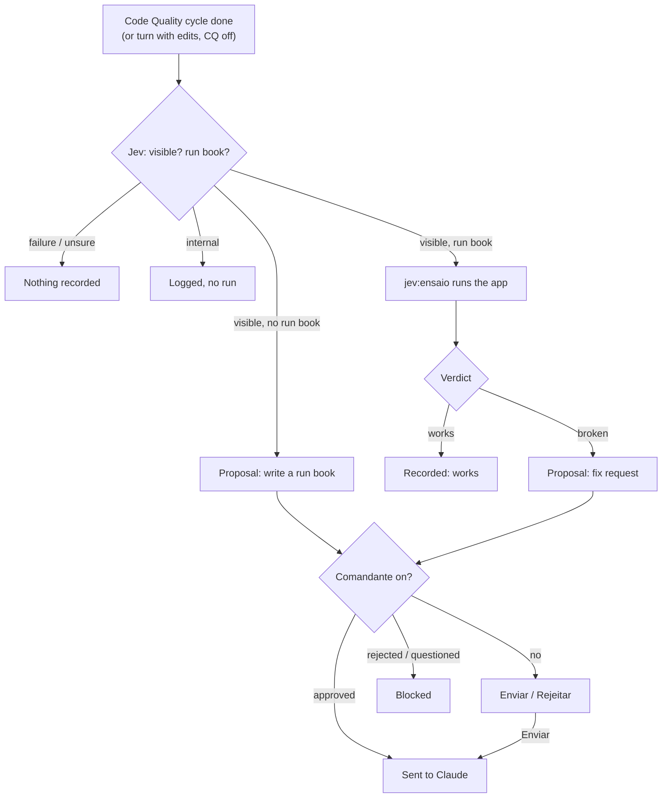

# Ensaio: runs the app after a visible change

After a change that someone using the app would see, Ensaio starts an agent that builds and opens the app, uses the
changed part, watches what happens and closes what it opened. A problem it sees becomes a fix request you can send to
Claude. A project with no known way to run its app gets a run-book request instead.

| | |
| --- | --- |
| Feature id | `ensaio` |
| Default | **Off** |
| How it runs | Jev decides whether the change is visible and whether the project says how to run it; Claude subagent `jev:ensaio` (Sonnet, 40 turns, background) does the run |
| Command | `/jev ensaio` opens the Autonomous tab (rail key `a`) |
| Code | `hooks/core/ensaio.ts`, `ENSAIO_SYSTEM` in `hooks/core/prompts.ts`; `ensaioConsider`, `ensaioStart`, `ensaioAgentEnded` in `hooks/register.tsx` |

## When it acts

- After a [Code Quality](code-quality.md) cycle ends successfully, with the cycle's files and summary.
- With Code Quality off: at the end of a main turn, not aborted, that edited files.

It needs a Jev key and no other Ensaio run in progress.

## How it works

1. **Facts.** The changed files, Code Quality's summary, the project's own commands and skills, and its
   `package.json` scripts.
2. **Jev decides.** Two choice questions: `visible` (would someone using the app see the change?) and `runbook` (does
   the project say how to build and launch its app?). A failed or low-confidence answer means no run and no record.
3. **Branches.**
   - *Internal change:* logged ("Jev saw nothing someone using the app would notice"), nothing runs.
   - *Another session is running the app or tests:* a "skipped" record.
   - *No run book:* a proposal asks Claude to write one (a project skill at `.claude/skills/run/SKILL.md`).
   - *Otherwise:* the agent runs.
4. **Run.** The agent finds the project's way to run the app (a run skill or command, else `dev`/`start`/`serve`
   scripts, a Makefile or the README), builds if needed, launches it (servers in the background), exercises the
   changed part, compares it with `git diff`, and stops every process it started. Vigia tells other sessions the app
   is running.
5. **Report.** `SUMMARY`, `RAN`, `VERDICT: works | broken | not_run`, `PROBLEM` and `FIX`. A broken verdict with
   problems or a fix becomes a proposal: "Ensaio ran the app … Fix it, then tell me what changed."
6. **Review.** When the orchestration review setting is on, the report gets an independent review; then the
   [Comandante](comandante.md) judges the proposal, if it is on.

## Limits (enforced by Pingo)

Every call goes through `ensaioVerdict`. The agent never writes, edits or deletes files, never starts agents or asks
you anything, and its shell commands are refused when they change git, delete files, install or publish packages, run
tests (only [Portão](portao.md) runs tests) or touch settings. A call your own settings would ask about is refused,
since nobody is there to answer. Builds may write their own output folders.

## What you see

- **Above the prompt** (or the Deck mascot): "running the app", "the app shows n problems", or "no way to run the app
  yet".
- **Autonomous tab:** one card per run with the changed files, the note, the problems and the verdict ("works /
  broken / could not run it"), and the proposal with **Enviar** and **Rejeitar**.

**Enviar** sends the request to Claude as your message ("Ensaio: the request went to Claude"). **Rejeitar** drops it.
With the Comandante on, an approved proposal is sent at once; a rejected or questioned one is blocked.

## Configuration

| Setting | Where | Default |
| --- | --- | --- |
| Ensaio on/off | AI screen, or `/jev feature ensaio on\|off` | Off |

The last 20 runs are kept. A run still going when the session restarts is marked failed.
