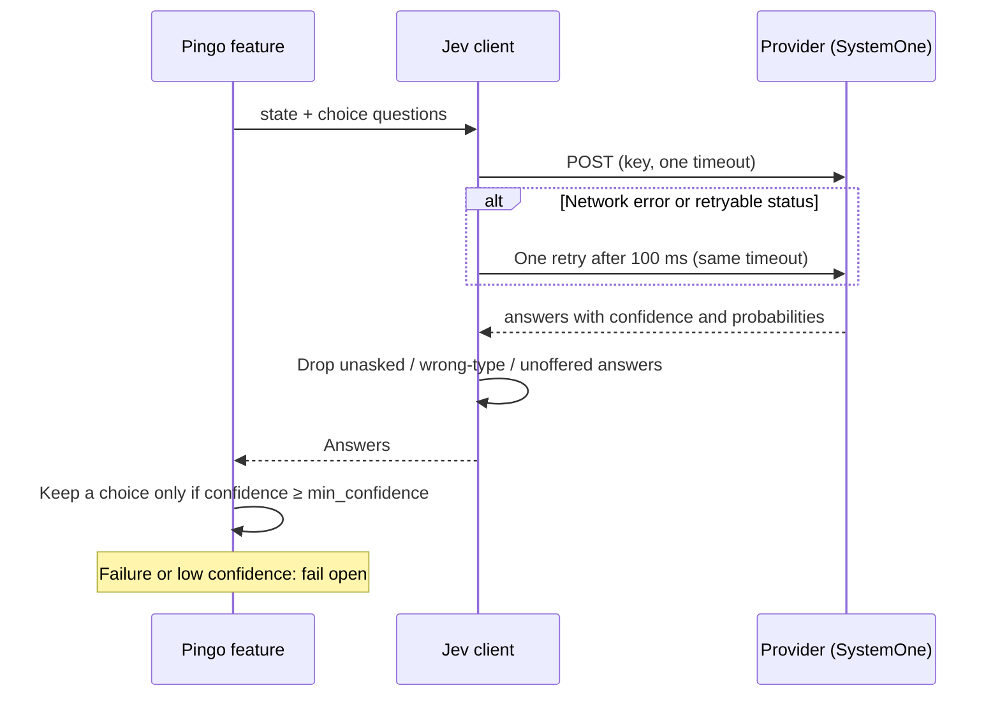

# Jev: the decision model behind Pingo's features

Jev is TypeSafe's structured decision model, reached over HTTP through the SystemOne API. Pingo never asks Jev to write
code or prose: it sends a small state and one or more **choice questions**, and Jev returns a choice with a confidence
for each. Pingo or Claude Code then acts on the answer.

| | |
| --- | --- |
| Feature id | None (Jev is the shared client). Routing switch: `/jev routing on\|off` |
| Default | Needs a provider key; routing on |
| Providers | TypeSafe, OpenRouter, Vercel AI Gateway, OpenCode |
| Commands | `/jev setup [provider]`, `/jev status`, `/jev routing on\|off` |
| Code | `hooks/core/jev.ts` (client), `hooks/core/request.ts`, `hooks/core/reasons.ts`, `hooks/core/selection.ts`; `tracedAskJev`, `jevReporter` in `hooks/register.tsx` |

## Who asks Jev

| Caller | What it asks |
| --- | --- |
| [Comandante](comandante.md) | Approve, reject or question an alert (8 verdicts) |
| [Portão](portao.md) | Hold the commit? Run tests? Security review? |
| [Rumo](rumo.md) | Is the condition checkable, how many turns? Then: met, not met, impossible? |
| [Ensaio](ensaio.md) | Is the change visible? Does the project say how to run the app? |
| [Chaveiro](chaveiro.md) | Read-only? Which rule? Which settings file? |
| [Oficina](oficina.md) | Are `claude doctor`'s findings worth showing? |
| [Context](../core/context-compaction.md) | Keep each old tool call and its result? |
| [Agent planning](../core/agent-planning.md) | Which model and effort for this subagent? |
| [Orchestration](../core/orchestration.md) | Objective continuity, work mode, profiles, guidance, concurrency |
| Setup | One trivial question to validate a key |
| [Sift](../features/sift.md) | Filter, classify, rank, find (separate process) |

Code Quality, Lapida, Resumo, Vigia's summary and Clareza's review use Claude, not Jev.

## How a call works

1. The feature builds a request: `state` (bounded facts, clipped), `questions` (each a `choice` with criteria per
   option), and the Jev `model`.
2. The client posts it to the provider's SystemOne URL with the key. The whole call has one timeout
   (`timeout_ms`, default 4,000 ms). A network error or a retryable status (408, 429, 500, 502, 503, 504, 529) is
   retried once after 100 ms, inside the same timeout. A timeout or an unusable reply is never retried.
3. The reply is validated: an answer to a question that was not asked, of the wrong type, or with an option that was
   not offered is dropped and recorded.
4. `readChoice` keeps an answer only if its confidence reaches `min_confidence` (default 0.7); below it the answer is
   held and the feature does nothing.
5. Any failure becomes a `jev_error` reason and the feature **fails open**: it carries on as if it were off.
6. Each call is logged as one "call" line in the live log, updated with the answers and probabilities, or the failure
   and a hint.

## The gate: routing versus key

- **Routing** (`/jev routing on|off`, on by default) gates only [orchestration](../core/orchestration.md),
  [agent planning](../core/agent-planning.md) and [advisor guidance](../core/orchestration.md#advisor-guidance)
  (which needs no key, but stops when routing is off).
- Portão, Rumo, Ensaio, Chaveiro, Oficina, the Comandante and Context check only that a **key** is set (and that their
  own switch is on). Sift never checks routing.
- The Comandante accepts Jev's verdict at any confidence; Context uses `context_keep_threshold` instead of
  `min_confidence`.

## Setup and keys

- `/jev setup [provider]` opens the AI screen with that provider selected. The key is never a command argument.
- **Test and save** makes one real call (15 s limit, no retry) with the pasted key. If it passes, the provider/key pair
  is saved in the plugin store, and Pingo also tries to save Claude Code's sensitive `api_key` option. If saving fails,
  the provider choice is rolled back.
- **Test connection** checks the key already configured. **Remove key** clears the stored copy; a key in the
  environment stays in use.
- Settings resolve as: plugin option, then environment variable (`JEV_PROVIDER`, `JEV_MIN_CONFIDENCE`,
  `JEV_TIMEOUT_MS`, the provider key variables), then default. A key from the `api_key` option is sent only to the
  provider it belongs to.

| Provider | Key variable | Default model |
| --- | --- | --- |
| TypeSafe | `TYPESAFE_API_KEY` | `jev-latest` |
| OpenRouter | `OPENROUTER_API_KEY` | `typesafe/jev-1.13` |
| Vercel AI Gateway | `AI_GATEWAY_API_KEY` | `typesafe-ai/jev` |
| OpenCode | `OPENCODE_API_KEY` | `jev-1.13-free` (also `jev-1.13`) |

## Where Jev shows up

- **Deck:** the Jev mascot stands on the lane while a call is open, with its errand in the balloon ("deciding whether
  to hold the commit", "picking model and effort for …"), and hops away when the last call ends. Jev also speaks for
  [Rumo](rumo.md).
- **Live tab:** the latest Jev call is pinned on top.
- **Logs tab:** the "AI calls" card lists every call with its answer or failure (including Pingo's Claude calls).

## To confirm

- The key storage text on the AI screen says the key is "never in the plugin's own state", while the code and the
  plugin manifest save the validated pair in the plugin store. One of them needs correcting.
