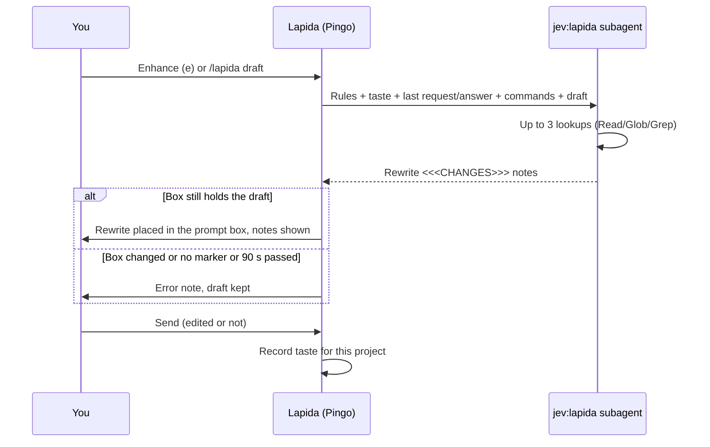

# Lapida: rewrites your draft prompt

Lapida rewrites the draft in your prompt box into a clearer, more complete request, using the project's context. The
rewrite replaces the draft in the box so you can review it before sending. Lapida learns from the edits you make
before you send.

| | |
| --- | --- |
| Feature id | `lapida` |
| Default | On |
| How it runs | Claude subagent `jev:lapida` (Sonnet, low effort, 6 turns, Read/Glob/Grep, background, 90 s limit) |
| Command | `/lapida <draft>` |
| Code | `hooks/core/lapida.ts`, `LAPIDA_SYSTEM` in `hooks/core/prompts.ts`, `enhanceLapida` and `lapidaAgentEnded` in `hooks/register.tsx` |

## When it acts

Only when you ask: the **Enhance (e)** button on the Lapida line above the prompt, or `/lapida <draft>`. A plain prompt
submit never starts a rewrite. Sending a new prompt (not a `/` command) while a rewrite runs cancels the rewrite.

## How it works

1. Lapida reads the draft. An empty draft gives "Type a prompt draft first."
2. It builds one request: the rewrite rules, a hint learned from your past edits ("taste"), your last request and
   Claude's last answer (up to 1,500 characters each), up to 40 installed commands, and the draft.
3. It starts the `jev:lapida` subagent. The agent may make at most three Read/Glob/Grep lookups to confirm that a
   file, symbol or command the draft names exists. It never carries out the task.
4. The answer must contain the `<<<CHANGES>>>` marker. The text before it is the rewrite; up to three short notes
   after it say what was added.
5. If the prompt box still holds the draft, the rewrite replaces it and the notes appear below the line. If the box
   changed meanwhile, the rewrite is discarded ("the prompt box changed while it worked").
6. When you send while a rewrite is in the box, Lapida records whether you sent it unchanged or edited it, and by how
   much. The next rewrites read that taste: more concise, more thorough, or the same style.

## What you see

- **Above the prompt:** "Lapida", "Lapida…" while working, "Lapida · review the rewrite" when ready, with
  **Enhance (e)** and **Send (s)**.
- **Deck:** the Lapida mascot says "rewriting the draft" while the agent works.

## Configuration

| Setting | Key | Default |
| --- | --- | --- |
| Lapida on/off | `/jev feature lapida on\|off` | On |
| Prompt learning (taste) | `promptLearning` | On |

Taste records are stored per project (`lapida:taste:<project root>`, last 10). The subagent type is hidden from
Claude's own agent list.

## To confirm

- With Lapida off, `/lapida <draft>` still answers "Lapida is rewriting the draft…" although no rewrite starts.
