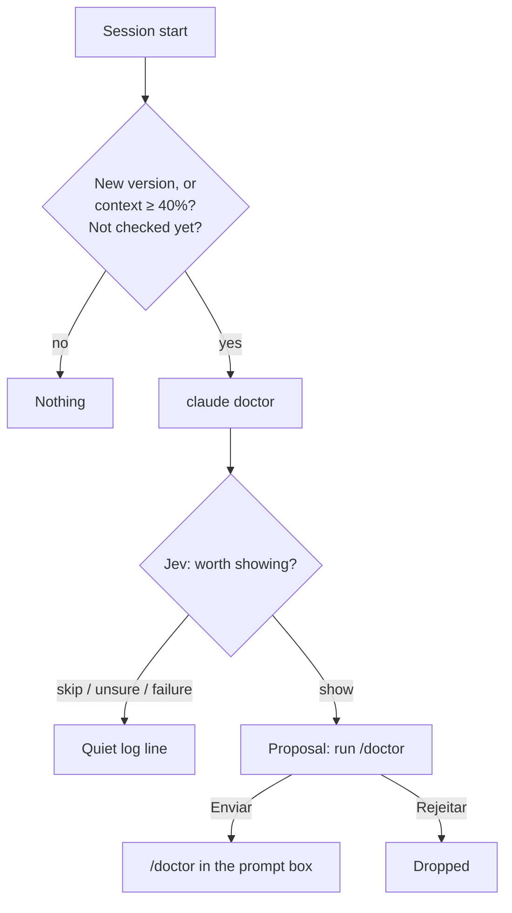

# Oficina: a checkup after a Claude Code update

When a session starts on a new Claude Code version, or with its context already very full, Oficina runs
`claude doctor` (which only reads) and asks Jev whether the findings are worth your time. When they are, it suggests
running `/doctor`.

| | |
| --- | --- |
| Feature id | `oficina` |
| Default | **Off** |
| How it runs | `claude doctor` as a process (60 s limit), then one Jev choice question |
| Command | `/jev oficina` opens the Autonomous tab (rail key `a`) |
| Code | `hooks/core/oficina.ts`; `oficinaSessionStarted`, `oficinaCheck`, `oficinaSend` in `hooks/register.tsx` |

## When it acts

At session start, in the background, once per Claude Code version:

- **New version:** the version differs from the one Oficina saw before.
- **Full context:** otherwise, the context is already at 40% or more at the start.

The very first session Oficina sees only learns the version (it can still trigger on a full context). The version is
marked as checked **before** the check runs, so a check that cannot ask Jev (no key) is not repeated for that version.

## How it works

1. Run `claude doctor` and keep the lines that name a problem (✗, ⚠, warning, error, failed, invalid, missing, not
   found, outdated, deprecated…), at most 12.
2. Ask Jev `worth`: **show** (an error, a broken setting, a failing MCP server or hook, an outdated install, or a
   context too full at start) or **skip**.
3. *Skip*, a low-confidence answer or a failed call: a quiet log line ("found nothing worth your time").
4. *Show:* a proposal waits for you.
5. **Enviar** puts `/doctor` in the prompt box; nothing runs on its own, you press Enter. **Rejeitar** drops it.

Oficina is not a [Comandante](comandante.md) source: its suggestion changes nothing by itself.

## What you see

- **Above the prompt** (hidden when the Deck lane is on screen, where the mascot says it): "? claude doctor found n
  things: run /doctor? · Oficina".
- **Deck:** the Oficina mascot says "running claude doctor" while it runs.
- **Autonomous tab:** one card per checkup with the reason ("New Claude Code version" or "The context was already very
  full at the start"), up to 8 findings, and **Enviar** / **Rejeitar**.

## Configuration

| Setting | Where | Default |
| --- | --- | --- |
| Oficina on/off | AI screen, or `/jev feature oficina on\|off` | Off |

The last 10 checkups and the last 10 checked versions are kept in the plugin store (`oficina:version`,
`oficina:checked`).
