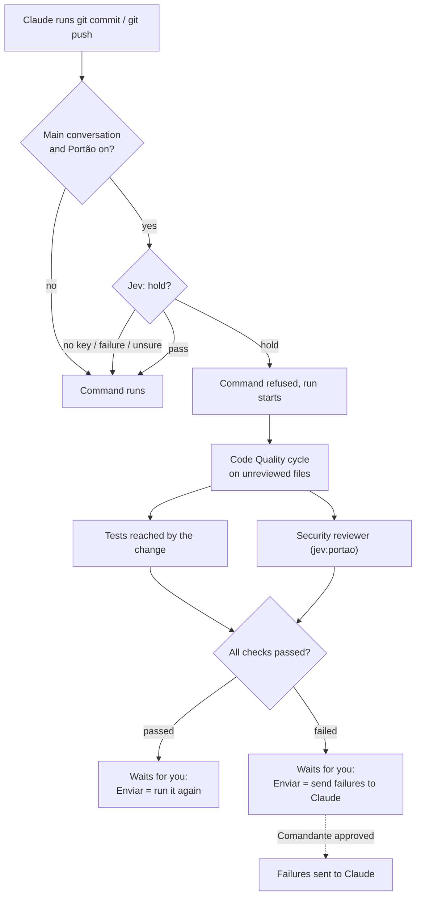

# Portão: a gate before `git commit` and `git push`

Portão holds Claude's `git commit` and `git push` when Jev judges that the change has not been checked. While the
command is held, the change goes through [Code Quality](code-quality.md), the tests it reaches and, when Jev asks for
one, a security review. Only you let the command through again.

| | |
| --- | --- |
| Feature id | `portao` |
| Default | **Off** |
| How it runs | Jev decides whether to hold and which checks to run; a Code Quality cycle; the project's test runner; Claude subagent `jev:portao` for the security review (Sonnet, 30 turns, read-only, background) |
| Command | `/jev portao` (or `portão`) opens the Autonomous tab (rail key `a`) |
| Code | `hooks/core/portao.ts`, `PORTAO_SYSTEM` in `hooks/core/prompts.ts`; `portaoGate`, `portaoAdvance`, `portaoSend` in `hooks/register.tsx` |

## When it acts

Before Claude's own shell call runs, when the command contains `git commit` or `git push` as a command of its own (at
the start, or after `&&`, `||`, `;`, `|` or a newline, with any git global options before the verb). Only calls of
the main conversation are gated; a subagent's commit or push is not.

If nothing changed since the last held run, the command is refused again with the same reason, without asking Jev.

## How it works

1. **Facts.** Pingo collects the changed files (and, for a push, the files of the commits it would send), the size of
   the change, the files no Code Quality cycle reviewed since they changed, whether Code Quality is on, the tests the
   change reaches, whether tests passed after the last edit, and whether another session is running tests.
2. **Jev decides.** One request with up to three choice questions: `hold` (hold / pass), `security` (review / skip),
   and `tests` (run / skip, asked only when some tests are reached).
   - **No key, a failed call, or a low-confidence hold answer:** the command runs and nothing is logged.
   - **Pass:** the command runs; "Portão: Jev let git commit through" is logged.
   - **Hold:** the command is refused with the hold reason, and a run starts.
3. **Code Quality first.** If changed files were not reviewed, Portão queues them and waits for a
   [Code Quality](code-quality.md) cycle. With Code Quality off, this check is skipped.
4. **Tests and security in parallel.**
   - Tests run with `node scripts/test.ts --only <regex>` (10 minute limit), covering only the test files whose name
     contains a changed file's name, or changed test files. **This needs the project to track `scripts/test.ts`**
     (Pingo's own runner); in other projects the check reports that no test reaches the change. Tests are skipped if
     another session of the project is running tests.
   - The security reviewer reads `git diff HEAD` and looks for injection, unsafe file writes or deletes, paths that
     escape the project, secrets, unchecked input, removed permission checks and unsafe network calls. It ends with
     `SUMMARY`, `ISSUE` and `VERDICT: pass | fail`. It runs under the same read-only rule as Code Quality's readers.
5. **Result.** The run is marked passed or failed and a proposal waits for you.

## Your actions (Autonomous tab)

| Button | Passed run | Failed run |
| --- | --- | --- |
| **Enviar** | Sends "the checks passed and I approve it. Run it again: `<command>`" as your message | Sends the failures to Claude to fix; the command stays held until Claude edits again |
| **Liberar mesmo assim** | Not shown | Lets it through as it is: sends "I let it through as it is. Run it again" as your message |
| **Rejeitar** | Drops the proposal; Claude's next try asks Jev again | Same |

Passed checks always wait for you: the [Comandante](comandante.md) judges only failed runs. When it approves, it sends
the failures to Claude for you, and the commit stays held. When it rejects or questions, the proposal is blocked;
**Rejeitar** and **Liberar** remain.

A security review shows "Independent review: approved" or "not verified". "Not verified" appears when the
orchestration review setting is off and is not a failure.

## What you see

- **Above the prompt:** "checking before git commit", "checks passed: git commit waits for you", or "held git commit:
  n failures". Pressing it opens the Autonomous tab. When the Deck mascot is shown, the mascot says it instead.
- **Autonomous tab:** one card per run with the Code Quality, Tests and Security review rows, findings, and the
  proposal with its buttons.

## Configuration

| Setting | Where | Default |
| --- | --- | --- |
| Portão on/off | AI screen, or `/jev feature portao on\|off` | Off |

The last 20 runs are kept. [Rumo](rumo.md) pauses while a Portão run is checking or waiting. Tests count as passed
when Claude itself runs `scripts/test.ts` successfully.

## After a reload

The plugin reloads when one of its own files changes, for example when Code Quality fixes a file under `hooks/` in
Pingo's own repository. The newest run still checking then picks up where it was
("Portão picked up the checks of git commit after a reload"):

- its change set is read again; Jev is not asked again;
- a check that ended keeps its result;
- Code Quality waits for a cycle only while a changed file is still unreviewed, and passes otherwise;
- the tests run again, since their process went with the reload;
- the security review is waited for while its reviewer is still at work, and starts again when it is gone.

Claude's next try is held by the same run. An older run still checking is marked failed, with "interrupted when the
session restarted".

## To confirm

- What happens to a run still checking when Claude edits and retries the command (a new run replaces it).
