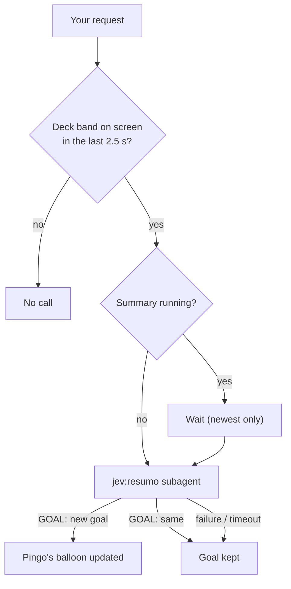

# Resumo: the session goal in Pingo's balloon

Resumo sums up, in one short sentence, what the session is working on. The sentence is shown in Pingo's speech balloon
on the Deck, so anyone who looks at the session can tell what it is for.

| | |
| --- | --- |
| Feature id | None. Resumo runs while the Deck pet lane is shown (`/deck` pet section on and `pingoVivo` on). |
| Default | On, with the pet lane |
| How it runs | Claude subagent `jev:resumo` (Sonnet, low effort, 2 turns, Read/Glob/Grep, background, 60 s limit) |
| Command | None. `/pingo hide` and `/pingo show` hide or show the lane. |
| Code | `hooks/core/resumo.ts`, `RESUMO_SYSTEM` in `hooks/core/prompts.ts`, `resumoPromptSubmitted` and `resumoEnded` in `hooks/register.tsx` |

## When it acts

On every request you send (typed, or through the bridge) when the Deck band was drawn on screen less than 2.5 s ago.
Prompts that plugins send never change the goal. Without a visible band, no call is made.

## How it works

1. If a summary is already running, the new request waits; only the newest waiting request is kept.
2. Resumo builds the request: the current goal, your previous request and Claude's last answer (to resolve "it" or
   "that"), the new request, and the language to write in. Each part is capped at 1,500 characters.
3. It starts the `jev:resumo` subagent. The agent answers at once, without tools, with a last line `GOAL: <goal>`: a
   verb-first sentence of at most 8 words, or `GOAL: same` when the request continues the current goal.
4. A new goal (cut to 120 characters) replaces the old one and the Deck redraws. `same` keeps it.
5. If the agent is refused, fails, times out after 60 s or writes no `GOAL` line, the previous goal stays.

## What you see

- **Pingo's balloon** on the Deck lane shows the goal, cut to the lane's width.
- **During a turn**, the line under the lane reads "Pingo: <goal>"; pressing it opens the Live tab.
- **Before the first goal**, Pingo speaks only while a turn runs, with his name and no text; between turns he has
  no balloon.

## Configuration

Nothing to set. The goal lives only in memory and is cleared on `/clear`, `/resume` and fork. The subagent type is
hidden from Claude's own agent list.

## To confirm

- Whether a `/` command you type also triggers a summary (the code does not filter them; it depends on whether Claude
  Code fires `prompt.submit` for commands).
- This feature was being changed by another session while this document was written; balloon details may move.
