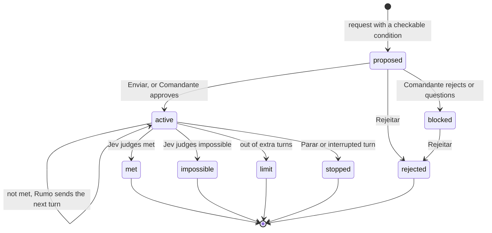

# Rumo: keep Claude working until a condition holds

When your request says when the work is done ("until the tests pass", "até o build passar"), Rumo asks Jev whether
that condition can be checked and proposes it as a goal. Once the goal starts, Claude keeps working, turn after turn,
until Jev judges the condition met, impossible, or out of turns.

| | |
| --- | --- |
| Feature id | `rumo` |
| Default | **Off** |
| How it runs | Jev: one request to propose the goal, one at the end of each of Claude's turns to judge it. No mascot: Jev speaks for Rumo. |
| Command | `/jev rumo` opens the Autonomous tab (rail key `a`) |
| Code | `hooks/core/rumo.ts`; `rumoPromptSubmitted`, `rumoJudge`, `rumoSend` in `hooks/register.tsx` |

## When it acts

- **Proposal:** on a request you type (or send through the bridge), when no goal is active, a Jev key is set, and the
  text has a completion cue: *until, till, so that, make sure, até (que), enquanto não, garanta que, certifique-se de
  que*. The condition is the clause after the cue (6–200 characters, at least two words).
- **Judging:** at the end of each main turn while a goal is active.

## How it works

1. **Propose.** Jev answers two questions: `goal` (checkable / vague / none) and `turns` (3, 8 or 15 extra turns; 8
   when unsure). Only a confident "checkable" creates a proposal. A newer proposal replaces an older one that was
   still waiting.
2. **Start.** You press **Enviar**, or the [Comandante](comandante.md) approves it. **When the Comandante approves, the
   goal starts with no click from you**; you can still press **Parar**.
3. **Judge.** When a turn ends, Jev reads Claude's last answer and answers `status`: met / not_met / impossible.
   - *Met* or *impossible:* the goal ends, with a log line and a toast.
   - *Out of turns:* the goal ends as "out of turns".
   - *Not met:* Rumo sends Claude a new prompt: `[Rumo] The goal is not met yet: "<condition>". Keep working toward
     it (extra turn n of max). When it holds, say so plainly; if you are blocked or need the user, say that instead.`
   - *Jev failed or unsure:* no prompt is sent; the goal waits for the next turn to end.
4. **Pause for Portão.** While a [Portão](portao.md) run is checking or waiting for you, judging pauses.
5. **Stop.** An interrupted turn stops the goal. **Parar** stops it yourself; **Rejeitar** drops a proposal.

## What you see

- **Above the prompt**, labelled **Jev** and shown even when the Deck lane is on screen: "? Jev · Rumo: keep going
  until <condition>?" for a proposal, "Jev · Rumo: until <condition> · turn n/max" while active. Pressing it opens the
  Autonomous tab.
- **Deck:** Jev's balloon speaks for Rumo ("reading the goal" while Jev judges).
- **Autonomous tab:** one card per goal with the condition, the request it came from, extra turns used, and
  **Enviar** / **Rejeitar** (proposed) or **Parar** (active). **Clear done** removes finished goals.

## Configuration

| Setting | Where | Default |
| --- | --- | --- |
| Rumo on/off | AI screen, or `/jev feature rumo on\|off` | Off |
| Minimum confidence | `min_confidence` | 0.7 |

The last 12 goals are kept. Your own prompts during an active goal do not start a new one; the goal is judged again
when that turn ends.

## To confirm

- Whether releasing a Portão hold restarts a goal that paused for it (no code calls the judge from Portão).
- What happens to an active goal when Rumo is turned off (judging stops, the goal stays active in the list).
