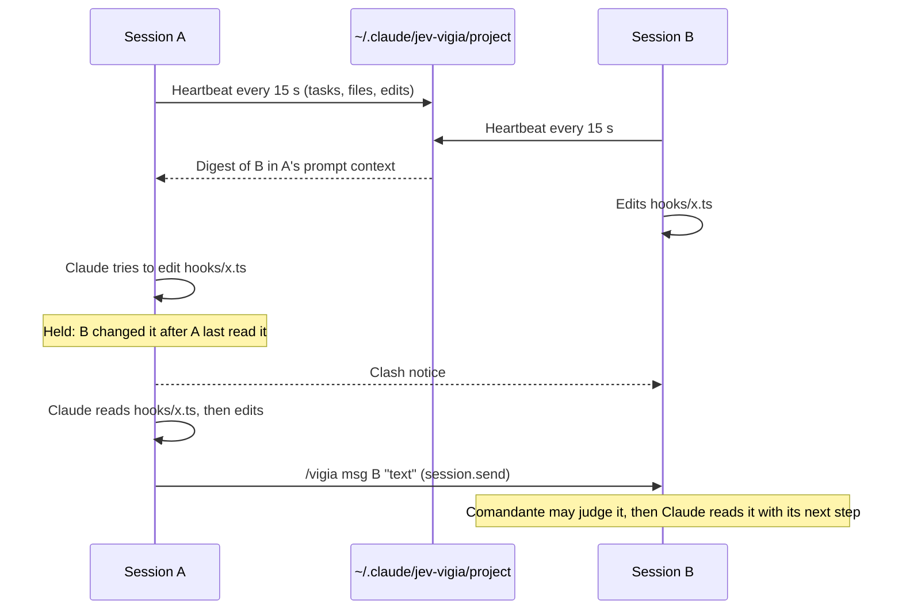

# Vigia: sessions of one project that see each other

Vigia tracks the Claude Code sessions working in the same project. Each session's Claude reads what the others are
doing, sessions can message each other, and an edit waits until Claude re-reads a file another live session just
changed, so their work is not overwritten.

| | |
| --- | --- |
| Feature id | `vigia` |
| Default | On |
| How it runs | No model for the digest, messages and edit holds. A short turn summary uses Claude Haiku (optional). Jev is involved only when the [Comandante](comandante.md) judges incoming messages. |
| Command | `/vigia` opens the pane; `/vigia msg <session\|all> <text>` sends a message |
| Code | `hooks/core/vigia.ts`; `registerVigia`, `vigiaPromptSubmit`, `vigiaReceive` in `hooks/register.tsx` |

## When it acts

- **Every 15 s:** the session rewrites its record (heartbeat).
- **Every prompt:** Claude's context gets the other sessions' digest (only when it changed) and any delivered messages.
- **Every edit** by the main conversation: the hold check.
- **Every main turn end:** an optional Haiku summary of the session for the others.
- **On a message** from another session.

## How it works

1. **Records.** Each session keeps `~/.claude/jev-vigia/<project>/<sessionId>.json`, where `<project>` is the project
   root with every non-alphanumeric character replaced by `-`. A record holds the session's name, last prompt (300
   characters), tasks (mirrored from `TodoWrite`, `TaskCreate`, `TaskUpdate`), recent files and edit times. A session
   is alive when it has not ended and its last beat is under 60 s old. Records older than 7 days are ignored, and only
   sessions that sent a prompt are listed.
2. **Digest.** Up to five other live sessions, in the order they started: what each is doing (or its last request),
   its next step and up to five recent project files. Claude reads it as context: "avoid redoing their work, and
   re-read a file they touched before you edit it".
3. **Edit hold.** Before an `Edit`, `Write` or `NotebookEdit` of the main conversation, Vigia checks whether another
   live session edited the file inside the clash window (default 30 minutes) and after this session last read or
   edited it. If so, the edit is refused with the reason, a toast says "Held an edit to <file>", and the other session
   gets a clash notice. A `Read` of the file clears the hold. After three holds for the same edit, it goes through.
4. **Messages.** `/vigia msg <target> <text>` (up to 2,000 characters) sends a letter with `$.session.send`. The target
   is `all`, an id prefix of four or more characters, a session name or part of one. The receiving session accepts
   letters only from this plugin and from sessions of the same project; the letter never starts a turn by itself, and
   Claude reads it with its next tool result or prompt.
5. **Comandante.** With it on, each incoming message (not clash notices) is judged: approved or questioned messages
   are delivered (with the question); rejected ones are held, and the pane offers **Release**.
6. **Coordination.** Sessions mark when they run tests or the app; [Portão](portao.md) skips its tests and
   [Ensaio](ensaio.md) skips its run while another session is doing the same (marks last 20 minutes).

## What you see

- **Vigia pane:** opens by itself at session start when other live sessions exist; lists them, their messages and
  held messages with **Release**. **Clear done** removes the messages that reached where they went; held and failed
  ones stay.
- **Above the prompt** (only with other live sessions): "Also working in this project · /vigia", and "File clash on
  <file> with <session>" when edits collide.
- **Deck:** the Vigia mascot says "summarizing this session for the others" while the summary runs.

## Configuration

| Setting | Key | Default |
| --- | --- | --- |
| Vigia on/off | `/jev feature vigia on\|off` | On |
| Turn summary (Haiku) | `trackerSummary` | On |
| Clash window (Features screen) | `clashMinutes` | 30 min (15 / 30 / 60) |

## Limits

- The hold covers `Edit`, `Write` and `NotebookEdit` in the main conversation; `MultiEdit` and subagent edits are not
  held.
- Messages are kept up to 20 per pane.
