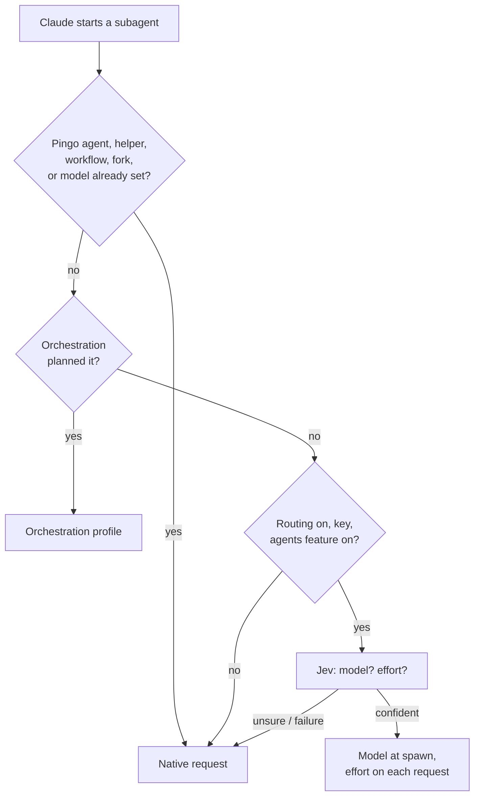

# Agent planning: model and effort for subagents

When Claude starts a subagent, agent planning asks Jev which Claude model and effort fit its task, unless the model was
already chosen. Claude Code still starts and runs the agent.

| | |
| --- | --- |
| Feature id | `agents` |
| Default | **Off** |
| How it runs | One Jev request with two choice questions (model, effort) |
| Gate | Routing on (`/jev routing on`), a key, and the feature on |
| Code | `hooks/core/plan.ts` (`planAgent`), `hooks/core/runtime.ts` (`sizeRequest`); the `agent.spawn` and `turn.step` hooks in `hooks/register.tsx` |

## When it acts

On `agent.spawn`, after these checks, in order:

1. Pingo's own agent types (Code Quality, Portão, Ensaio, Lapida, Resumo) pass through untouched.
2. Helpers started by Code Quality follow Code Quality's rules instead.
3. Workflow agents pass through.
4. [Orchestration](orchestration.md) plans first, when its policy is on; agent planning runs only when it did not.
5. Agent planning runs only when the gate is open, the spawn is not a fork, and Claude did not choose a model.

`Explore` and `Plan` agents keep Claude's native choices.

## How it works

1. Jev gets the agent type, a bounded description (400 characters) and prompt, and the available models.
2. It answers a model tier (Haiku, Sonnet, Opus) and an effort (`low` … `max`), each with a confidence.
3. A choice below `min_confidence` is held and logged; the native request stays as it was.
4. The model is applied at spawn. The effort is applied on each request of the subagent, and only when its model
   supports effort (for Haiku the planned effort is ignored and logged).
5. If the feature is turned off while Jev answers, the plan is dropped.

## What you see

A live-log line "chose …" with Jev's latency, a "started #n" line with the model, effort and task, and the run on the
Agents tab. Ignored efforts are logged as warnings.

## Configuration

| Setting | Where | Default |
| --- | --- | --- |
| Subagent model and effort | AI screen, or `/jev feature agents on\|off` | Off |
| Models offered | `claude_models` option | Built-in list |
| Minimum confidence | `min_confidence` | 0.7 |

Sending planning to Jev shares the agent type and a bounded task description with the provider. Its benefit has not
been established; see the [evaluation protocol](../../bench/protocol.md).
