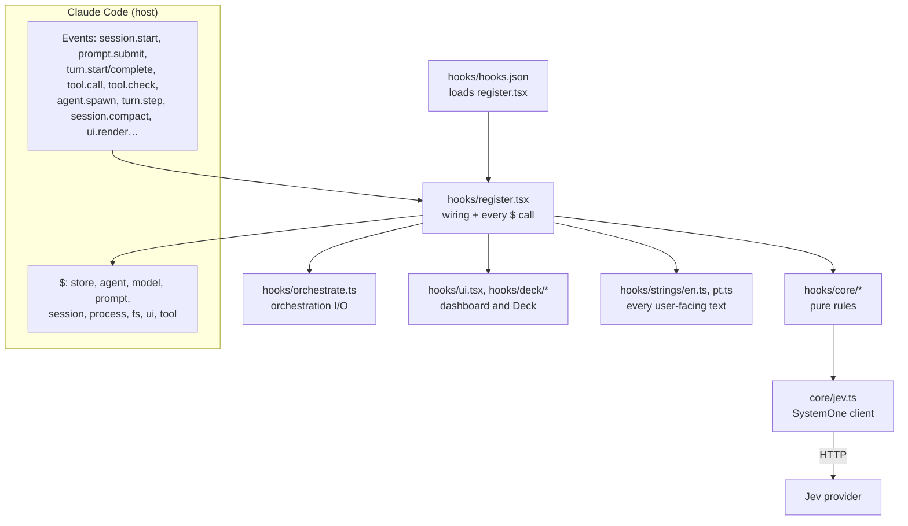
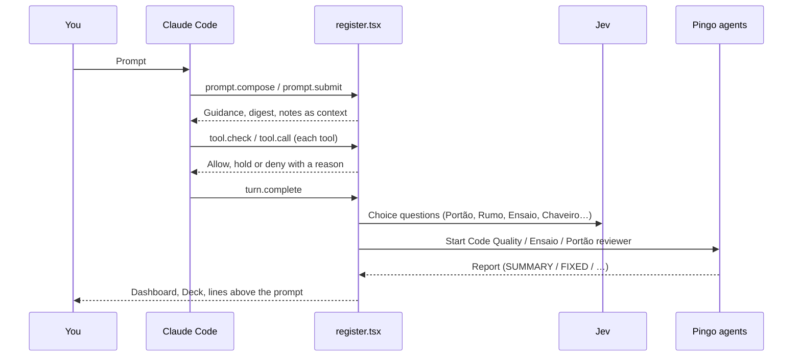

# How the Pingo core works

Pingo is a Claude Code mod. One module, `hooks/register.tsx`, subscribes to the session's events and makes every call
to the host (`$`). The modules in `hooks/core/` are pure: they hold the rules (questions for Jev, how answers are read,
plan validation, report parsing, permission rules) and never touch the host. This split keeps the rules testable and
puts every side effect in one place.

## Layers

## The core modules

| Module | Role |
| --- | --- |
| `types.ts` | SystemOne wire format: requests, choice and `noul` questions, answers, usage. |
| `contracts.ts` | Shared constants: `DEFAULT_FEATURES`, efforts, the Claude model catalogue, orchestration roles. |
| `jev.ts` | The Jev client: providers, URLs, one call with one timeout and one retry, reply validation, key check. |
| `request.ts` | `askTimed`: one Jev call that turns an error into a fail-open reason. |
| `selection.ts` | `readChoice`: keeps an answer only if it is valid and above `min_confidence`. |
| `reasons.ts` | Reason codes (`routing_disabled`, `no_api_key`, `jev_error`…) and the gate. |
| `runtime.ts` | `featureGate`, `sizeRequest` (effort only on models that support it), usage reading. |
| `state.ts` | `truncate`: keeps the head and tail of long text. |
| `plan.ts` | [Agent planning](agent-planning.md): Jev picks a subagent's model and effort. |
| `orchestration.ts` | [Orchestration](orchestration.md) policy, limits, profiles, Jev questions, `/jev orch` commands. |
| `objective.ts` | One objective per human input: continuity, work mode, executor profile. |
| `advice.ts` | Local decision (no model) on whether a prompt gets planning guidance. |
| `queue.ts` | Managed batch state machine: admission, reviews, repairs, integration. |
| `review.ts` | Independent review and guidance through `$.model.complete`, with strict reply validation. |
| `prompts.ts` | System prompts of Pingo's agents and of review and guidance. |
| `compaction.ts` | [Context compaction](context-compaction.md): which old tool calls to keep. |
| `comandante.ts` | [Comandante](../agents/comandante.md) question, verdicts and log records. |
| `quality.ts` | [Code Quality](../agents/code-quality.md) request, permission rule, report parsing (shared by other agents). |
| `portao.ts`, `ensaio.ts`, `rumo.ts`, `chaveiro.ts`, `oficina.ts` | The autonomous agents' pure parts. |
| `lapida.ts`, `resumo.ts` | Request and answer parsing for [Lapida](../agents/lapida.md) and [Resumo](../agents/resumo.md). |
| `vigia.ts` | [Vigia](../agents/vigia.md) records, letters, digest and edit holds. |
| `sift.ts`, `channel.ts` | [Sift](../features/sift.md) helpers and the channel that relays Sift's Jev calls to the mod. |

## Lifecycle of a session

1. **Start.** `session.start` registers `/jev`, `/deck` and `/pingo` first, so a broken store never hides `/jev`. Each
   feature then starts in its own step; one that fails is logged and the next still starts. Order: stored state,
   orchestration, Farol, Clareza, Prisma, Semente, Lapida, Sentinela, Vigia, Comandante, Code Quality, Portão, Ensaio,
   Oficina (in the background), then the Deck.
2. **Prompt.** `prompt.compose` lets Farol, Clareza, Semente and Prisma add guidance sections. `prompt.submit` runs
   Clareza, Lapida, Vigia and orchestration, whose notes become the prompt's context; Rumo and Resumo run alongside
   without holding the prompt.
3. **Each model request.** `turn.step` applies the orchestration executor profile or a subagent's planned effort and
   records a request event.
4. **Each tool call.** `tool.call` feeds the Deck, the live log and Flow; holds an edit for [Vigia](../agents/vigia.md);
   holds a commit for [Portão](../agents/portao.md); tracks edits for Code Quality; and handles Pingo's own tools.
   `tool.check` applies the permission rules of Pingo's agents and counts approvals for Chaveiro.
5. **Subagents.** `agent.offer` hides Pingo's own agent types from Claude. `agent.spawn` plans model and effort or
   applies orchestration profiles.
6. **Turn end.** `turn.complete` runs each feature's end handler (Code Quality, Ensaio, Rumo, Chaveiro, Clareza,
   Semente, Vigia…) and then checks whether the context needs [compaction](context-compaction.md).
7. **Compaction.** `session.compact` lets Context replace Claude's summary with Jev's keep/drop decisions.

## Three ways Pingo reaches a model

| Path | Used by | Notes |
| --- | --- | --- |
| **Jev** (SystemOne over HTTP) | Comandante, Portão, Rumo, Ensaio, Chaveiro, Oficina, Context, agent planning, orchestration, Sift | Choice questions only. See [Jev](../agents/jev.md). |
| **Claude subagents** (`$.agent.register` / `$.agent.spawn`) | Code Quality (`jev:code-quality`), Portão reviewer (`jev:portao`), Ensaio (`jev:ensaio`), Lapida (`jev:lapida`), Resumo (`jev:resumo`) | All Sonnet, in the background, hidden from Claude. Orchestration workers are plain `general-purpose` agents. |
| **`$.model.complete`** | Clareza's answer review and Vigia's turn summary (Haiku); orchestration review and guidance | One call with a fixed system prompt; replies are validated. |

## Rules that hold everywhere

- **Fail open.** A missing key, a timeout, a malformed reply or a low-confidence answer leaves the session as if the
  feature were off. Only an answer above `min_confidence` changes anything.
- **The gate.** Orchestration and agent planning need routing on and a key. The other Jev features need their switch
  and a key.
- **Your consent.** Rewrites, fix requests, permission rules and re-run commands wait for **Send**/**Enviar**, unless
  you turned the [Comandante](../agents/comandante.md) on for that source. Chaveiro's rules and Portão's passed runs
  always wait for you.
- **Pingo's agents run unattended under code-enforced limits.** `tool.check` replaces the session's permission
  decision for their calls with `qualityVerdict` (Code Quality and its helpers; a read-only variant for Portão's
  reviewer) or `ensaioVerdict`. The session's own refusals still apply.
- **Model-facing tools.** Pingo registers four tools, seen by Claude as `mcp__jev__*`: `farol_assumption`,
  `semente_shelve`, `managed_batch` and `managed_batch_status`.
- **Texts.** Every user-facing text comes from `hooks/strings/en.ts` and `pt.ts`.

## State

| Where | What | Lifetime |
| --- | --- | --- |
| Host atoms (`atom({ plugin: "jev", key })`) | Live log (1,000 lines), agent runs (40), Flow (40 runs), feature runs (Code Quality, Portão, Ensaio, Rumo, Chaveiro, Oficina) and per-session state | Session; restored or reset on `/clear`, `/resume` and fork |
| Plugin store, global (`~/.claude/plugins/store`) | `events` (last 500 request records), `routing`, `features`, `featurePreferences`, `credentials`, `provider`, `locale`, Deck settings, `orchestration.v1`, `clareza:terms`, `oficina:*` | Across sessions |
| Plugin store, per project (`<key>:<project root>`) | Farol rules, Semente ideas, Prisma decisions, Lapida taste | Across sessions |
| Plugin store, per session | `orchestration.objective:<sessionId>` (others pruned after 7 days) | Across restarts |
| Files under `~/.claude/jev-vigia/<project>/` | Vigia session records; `comandante/<sessionId>.json` rulings | Shared by the project's sessions |

Writes to the request log are serialized, because the store has no compare-and-set.

## What the numbers mean

- Task timing starts when the prompt is submitted. Main-response and background-completion timing are separate;
  parallel work counts as elapsed wall time, not as summed overlaps.
- Main, worker, cache and Jev usage are reported separately. Unreported usage or prices stay unknown; known provider
  subtotals are marked partial or estimated.
- "Review requested", "advisor call observed" and "result verified" are separate facts. An observed response or tool
  call does not prove that a result was verified.
- Some remote workflow agents have no local completion event, so their completion and usage can stay unknown; not
  every runtime event reports advisor model or token usage.

## Related documents

- [Orchestration](orchestration.md), [Context compaction](context-compaction.md), [Agent planning](agent-planning.md)
- [docs/jev-orchestration-plan.md](../jev-orchestration-plan.md): the orchestration design and its exact prompts
- [DESIGN.md](../../DESIGN.md) and [docs/style-system.md](../style-system.md): the visual system
