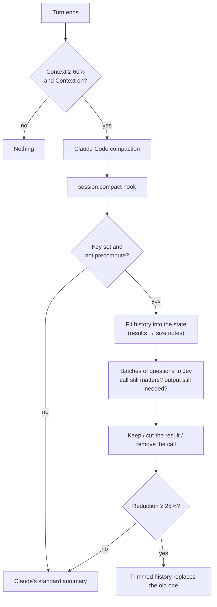

# Context compaction: Jev decides what old tool output to drop

When the conversation fills the context window, Claude Code normally replaces old history with a summary. With the
Context feature on, Pingo first asks Jev, for each older tool call, whether the call and its result still matter. It
removes or shortens what does not, keeps recent messages intact, and falls back to Claude's own summary when the gain
is small.

| | |
| --- | --- |
| Feature id | `contexto` |
| Default | On (needs a Jev key) |
| How it runs | Jev, in batches: two probability (`noul`) questions per tool call |
| Code | `hooks/core/compaction.ts`; `compactContextAfterTurn`, `contextAsker` and the `session.compact` hook in `hooks/register.tsx` |

## When it acts

- **After every turn** (main or subagent), if the context usage is at or above `context_compact_at_percent` (60% by
  default), Pingo asks Claude Code to compact. Only one compaction runs at a time.
- **On every compaction** that reaches the `session.compact` hook. A `precompute` trigger is skipped ("Contexto compacts
  only when the compaction happens").

## How it works

1. **Collect.** Every tool call outside the pinned messages (the first ones and the newest
   `context_preserve_recent_messages`, default 6) is a candidate.
2. **Fit the state.** The whole history, with tool results replaced by status and size notes and tool inputs
   abbreviated, is fitted into `context_max_state_tokens` (25,000). The goal comes from `context_goal`, or from the last
   three user prompts.
3. **Ask Jev in batches.** Candidates are split into batches that fit `context_max_request_tokens` (30,000) together
   with the state, and a few batches run at a time. For each call Jev gives two probabilities: that the call (with its
   input) still matters, and that its full output is still needed verbatim. A missing or malformed answer keeps the
   call.
4. **Decide** against `context_keep_threshold` (0.5):
   - output still needed: the call stays as it is;
   - only the call matters: its result is cut to the first `context_truncate_head_chars` (300) characters plus a
     note ("context compaction removed n chars of this tool result; re-run the tool if needed");
   - neither: the call and its result are removed.
   Messages left empty are removed.
5. **Apply or fall back.**
   - Reduction at or above `context_min_reduction_ratio` (25% of history characters): the trimmed messages replace
     the history, with no summary ("Context compacted to after/before messages without a summary").
   - Smaller reduction: Claude's standard summary runs ("reduction was below …").
   - Any error, or no key: Claude's standard summary runs.
6. **Report.** The live log gets each decision (`id:tool:action`) and a summary line; a toast shows the result for 15 s.
   The Context mascot is on the Deck while Jev works.

## Configuration

Set on the AI screen or with `/plugin configure jev@inline`. Context uses the same provider, key and Jev model as the
rest of Pingo.

| Option | Default | Purpose |
| --- | --- | --- |
| `context_goal` | Empty | Task goal; empty derives it from the last three user prompts. |
| `context_compact_at_percent` | `60` | Context usage that starts a compaction. |
| `context_min_reduction_ratio` | `0.25` | Minimum share of history characters removed before replacing Claude's summary. |
| `context_keep_threshold` | `0.5` | Jev probability needed to keep a call or its full result. |
| `context_preserve_recent_messages` | `6` | Newest messages left untouched. |
| `context_max_state_tokens` | `25000` | Estimated ceiling for the history sent with each request. |
| `context_max_request_tokens` | `30000` | Estimated ceiling for the state and questions in one request. |
| `context_truncate_head_chars` | `300` | Characters kept when a result is shortened. |

## Data sent

Fitted conversation text, the task goal and abbreviated tool inputs go to the Jev provider; tool outputs are replaced
by status and size notes. Limits do not redact secrets inside normal content.

## To confirm

- How subagent turns and `precompute` compactions are handled: another session was changing this while this document
  was written.
- Whether a manual `/compact` reaches the hook with a trigger other than `precompute` (inferred, not traced).
