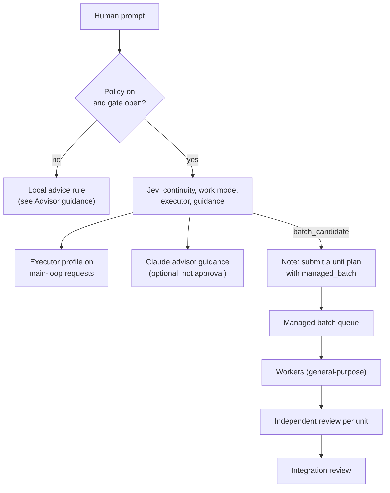
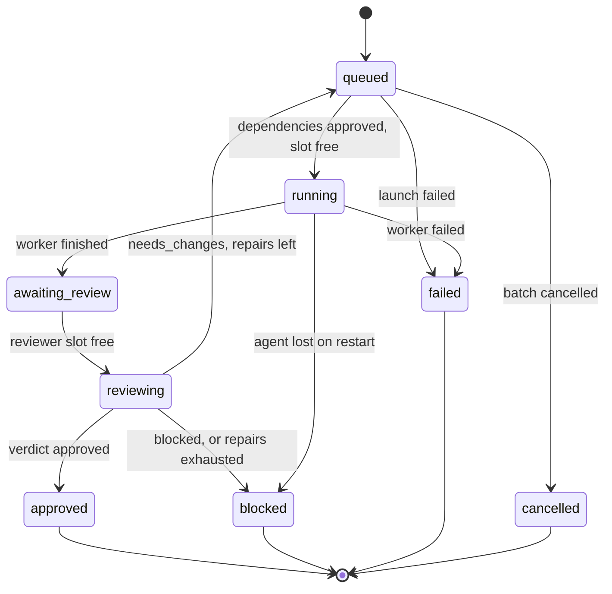

# Orchestration: objectives, advice, managed batches and independent review

Orchestration is an optional policy layer. When enabled, each human prompt becomes (or continues) an **objective**:
Jev decides whether the prompt continues the current work, which work mode it needs and which model and effort the
main loop runs with. Subagent results are **independently reviewed**, and work that splits into independent units can
run as a **managed batch** with dependencies, limits, repairs and a final integration review. A smaller part, the
**advisor guidance**, works even when orchestration is off.

| | |
| --- | --- |
| Policy | `orchestration.v1` in the plugin store; **off** by default |
| Gate | Routing on and a Jev key |
| How it runs | Jev (decisions), Claude through `$.model.complete` (guidance and reviews), `general-purpose` subagents (batch workers) |
| Commands | `/jev orch [setting]` (rail key `o`) |
| Code | `hooks/core/objective.ts`, `orchestration.ts`, `advice.ts`, `queue.ts`, `review.ts`, `prompts.ts`; `hooks/orchestrate.ts` |
| Design | [docs/jev-orchestration-plan.md](../jev-orchestration-plan.md) has the exact prompts and the full plan |

## When it acts

- **Each human prompt** (typed, bridge or SDK, not a message typed during a running turn).
- **Each subagent spawn** (profiles) and **each subagent end** (review).
- **When Claude calls `managed_batch`**, or runs `/batch` (which gets the managed-batch instruction).

## How it works

1. **Objective.** One Jev request asks: `continuity` (continue / revise / new, when an objective is active),
   `work_mode` (direct / managed / batch_candidate), the executor profile (when more than one is allowed), and
   `guidance` (none / plan / recover, while advice calls remain). Unsure answers keep the active plan, default the mode
   to *managed*, and leave the executor native. A failed call keeps the active objective as it was.
2. **Executor.** While the objective has an executor profile, each main-loop request is sent with its model and effort
   (effort only where the model supports it). Your own `/model` switch drops the executor until the next objective.
3. **Guidance.** When Jev (or the fixed `advice on` setting) asks for it, a Claude advisor writes bounded planning or
   recovery advice. It reaches Claude as "Pingo advisor guidance (plan; optional, not approval)". The advisor has no
   tools, no history and never approves.
4. **Subagents.** Profiles for workers and reviewers are chosen per spawn. After a delegated result, an independent
   reviewer (`$.model.complete`, `REVIEW_SYSTEM`) checks the exact answer and the `git diff` of the files it edited
   against the task. A foreground agent's verdict is added to its tool result; a background agent's verdict is
   delivered with your next prompt. A worker's own account is a claim, never proof.
5. **Managed batch.** Claude submits a unit plan through `mcp__jev__managed_batch` (IDs, descriptions, dependencies,
   affected areas, acceptance criteria, verification commands). Pingo validates it, picks a worker and a reviewer
   profile per unit and an integration reviewer, asks Jev for concurrency, and runs the queue. Claude follows progress
   with `mcp__jev__managed_batch_status` and must not launch the units itself.

## Managed batch states

Each unit moves through this state machine (`hooks/core/queue.ts`). Approval binds to a digest of the exact answer
and files; a repair invalidates an earlier approval. The batch is verified only when every unit is approved and the
integration review approves the same digests.

Admission respects the worker limit, the reviewer limit and the total active-call limit, and keeps a review slot
reserved for every unit waiting for review. Cancelling stops new launches; running work finishes and is still
reviewed. After a restart, a unit whose agent is gone is blocked, never relaunched twice.

## Advisor guidance

Guidance has its own setting (`advice auto|on|off`, default **auto**) and runs even when the orchestration policy is
off:

- **Policy off (default), or no key:** a local rule (`advice.ts`, no model call) scores the prompt from its length,
  steps, code, file names, and design, diagnosis, risk or build words. Short prompts, chit-chat and short questions
  score low. From a score of 4 the prompt gets guidance from a Claude advisor: Sonnet high (score 4+), Opus high (6+)
  or Fable high (9+), or the nearest allowed profile. At most `limits.adviceCalls` (3) per session, 30 s each.
- **Routing off:** no guidance at all.
- **Policy on:** Jev decides per objective, within the same allowance.

## Limits

| Limit | Default | Range | `/jev orch limit` name |
| --- | --- | --- | --- |
| Simultaneous workers | 3 | 1–16 | `workers` |
| Simultaneous reviewers | 1 | 1–8 | `reviewers` |
| Total active calls | 4 | 1–24 | `calls` |
| Units per batch | 30 | 1–200 | `units` |
| Minimum units for a batch | 5 | 1–200 | `batchmin` |
| Advice calls (per objective; per session when the policy is off) | 3 | 0–20 | `advice` |
| Repair rounds per unit | 2 | 0–10 | `repairs` |
| Review passes per unit | 3 | 1–10 | `reviews` |
| Worker turns | 25 | 1–200 | `turns` |
| Call timeout | 120,000 ms | 10,000–600,000 | `timeout` |

## Commands

`/jev orch` with no argument opens the Orchestration screen. Each edit bumps the policy revision and applies from the
next objective; `apply` applies it to the current one at the next request.

| Command | Effect |
| --- | --- |
| `on`, `off`, `reset` | Enable, disable or reset the policy. |
| `review on\|off` | Independent review of delegated results. |
| `advice auto\|on\|off` | Advisor guidance. |
| `batch auto\|off` | Managed batches. |
| `native off\|auto\|fixed <model>` | Claude Code's native advisor model option. |
| `limit <name> <n>` | Set a limit (table above). |
| `role <executor\|subagent\|advisor> model auto\|fixed <m>\|allow <m>\|fallback <m,…\|none>` | Model policy per role. |
| `role <…> effort auto\|fixed <level>\|allow <level>\|fallback <level,…\|none>` | Effort policy per role. |
| `override <role> <model\|-> [effort\|-]`, `override clear` | Trusted override for the next objective. |
| `agent <type> <model\|-> [effort\|-]` | Profile refinement for one agent type. |
| `apply`, `cancel [batchId]`, `end` | Apply to the current objective, cancel a batch, end the objective. |

## What you see

The Orchestration screen shows the policy and its draft, the current objective (id, work mode, requested, applied and
observed executor, pending apply) and the last five batches (approved/total, integration state, verified, cancelled).
Every advisor decision and review is logged in Live and Flow.
