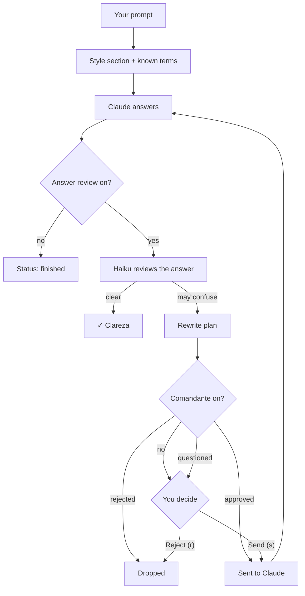

# Clareza: clear answers at your level

Clareza keeps Claude's replies at the technical level you choose, checks each finished answer with a small Claude
model, and, when an answer may confuse you, prepares a rewrite request that you can send or reject.

| | |
| --- | --- |
| Feature id | `clareza` |
| Default | On |
| Model | Claude Haiku through `$.model.complete` (answer review only). Not Jev, not a subagent. |
| Command | `/clareza [simple\|technical\|know <term>\|forget]` |
| Code | `clarezaCompose`, `clarezaTurnCompleted`, `reviewClareza`, `clarezaAbove` in `hooks/register.tsx` |

## When it acts

- **Every prompt:** it adds a reply-style section to Claude's context.
- **At the end of each main turn:** it reviews the answer, if **Answer review** is on.

## How it works

1. **Style.** Each prompt gets a style section: *Simple* (everyday words) or *Technical* (a technical reader). Both ask
   for complete, self-contained replies that end work with **Done:**, **Not done:** and **Your next step:**.
2. **Known terms.** At the Simple level, terms you marked as known are sent once as context, so Claude stops
   explaining them.
3. **Review.** When a main turn ends with an answer, Haiku reviews it (300 tokens max, 15 s timeout). At the Simple
   level it also offers up to six terms the answer explained, so you can mark them as known.
4. **Rewrite plan.** If the review fails, the turn was not already a rewrite, and the answer is not empty, Clareza
   writes a plan: a `[Clareza]` request asking Claude to rewrite its last answer as one complete answer, without tools.
5. **Your decision.** **Send (s)** submits the plan to Claude; **Reject (r)** drops it. With the
   [Comandante](../agents/comandante.md) on, the plan is judged first: approved plans are sent for you (or wait if a
   turn is running), rejected plans are dropped, questioned plans are shown with the question.
6. **Completion sound.** A turn longer than 30 s ends with a toast ("Pingo finished and needs you") and a sound, if the
   sound preference is on.

## What you see

- **Above the prompt:** a status line ("✓ Clareza", or "✗ problems · see plan" when a plan waits), and at the Simple
  level an "I know this:" row with one button per term.
- **Clareza pane:** "What may confuse", the exact request Claude would get, and **Send (s)** / **Reject (r)** (or
  **Clear done** when the Comandante already sent it).
- **Deck:** the Clareza mascot says "reviewing the answer" or "I have a plan to rewrite the last answer".

## Configuration and commands

| Setting | Key | Default |
| --- | --- | --- |
| Reply style (Simple / Technical) | `plainLevel` | Simple (`beginner`) |
| Answer review | `plainReview` | On |
| Completion sound (Features screen) | `plainSound` | On |

| Command | Effect |
| --- | --- |
| `/clareza` | Show the level and the number of known terms. |
| `/clareza simple` / `/clareza technical` | Set the level. |
| `/clareza know <term, term>` | Add known terms; with no term, list them. |
| `/clareza forget` | Clear all known terms. |

Known terms are stored globally (`clareza:terms`, last 300), not per project. The plan and grade reset on `/clear`,
`/resume` and fork.
