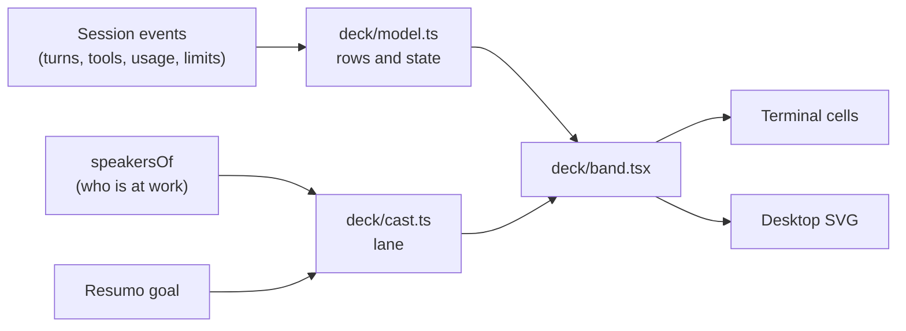

# Deck and Pingo Vivo: the status band and its mascots

The **Deck** is a band above the prompt box that shows the session at a glance: plan and task bars, running agents,
context and rate-limit meters, Pingo's routing decision, the clock and, optionally, the weather. **Pingo Vivo** adds
the mascot lane: Pingo always stands there, and everyone at work (Jev, a busy feature, a running subagent) joins him
with a speech balloon.

| | |
| --- | --- |
| Feature id | `pingoVivo` (the mascot lane); the band itself is controlled by `/deck` |
| Default | On |
| Model | None (Pingo's balloon text comes from [Resumo](../agents/resumo.md)) |
| Commands | `/deck [...]`, `/pingo [...]`, `/jev deck` (settings screen) |
| Code | `hooks/deck/` (`model.ts`, `band.tsx`, `cast.ts`, `pet.ts`, `rows.ts`, `settings.ts`, `wire.ts`, styles and theme); `deckBandOf`, `speakersOf` in `hooks/register.tsx` |

## What the band shows

- **Sections** (each can be turned off): `plans`, `agents`, `context`, `limits`, `route`, `pet`, `clock`, `weather`.
  All are on by default except `weather`.
- **Rows:** Pingo's route decision (model and effort), plan and task bars, an agents bar, an activity line, a context
  meter (warns at 60%, hot at 80%) and one meter per rate limit with its reset time.
- **Collapsed** as chips, one text line or rings, with whatever needs you first. **Expanded** with a header, the
  feature switches, the rows (each dismissable with ✕) and the mascot lane.
- **Footer:** a "Deck N" button that counts live bars.
- **Styles:** `pixel`, `segments`, `line`, `solid`, `dots`, `spark`, on the terminal and on the desktop app.

## The mascot lane

- **Pingo** is fixed. His balloon shows the session goal written by [Resumo](../agents/resumo.md).
- **Jev** appears while one of its calls is open, with its errand in the balloon.
- **Features** appear while they work or while something waits for you: Clareza, Semente, Farol, Vigia, Sentinela,
  Prisma, Lapida, Context, Code Quality, Comandante, Portão, Ensaio, Chaveiro, Oficina. Features stand to Pingo's left.
- **Subagents** appear to Pingo's right while they run, labelled `<mascot>·<type>`. The five subagent mascots (Tetra,
  Gem, Can, Coil and Top) are visual identifiers for concurrent workers, not job roles.
- Whoever finishes stays for a 1.5 s goodbye hop, marked as failed when its task failed, and leaves.
- A speech line under the lane shows the first speaker's words with an "open" pill; pressing it opens that feature's
  pane or tab.

When the lane is shown, several features (Farol, Semente, Chaveiro, Oficina, Portão, Ensaio, Sentinela) let their
mascot speak instead of drawing their own line above the prompt.

## Commands

| Command | Effect |
| --- | --- |
| `/deck` | Show or hide the band. |
| `/deck expand` / `collapse` | Expand or collapse it. |
| `/deck style [name]` | Open the style picker, or set a style. |
| `/deck <section>\|all on\|off` | Turn sections on or off. |
| `/deck collapsed chips\|text\|rings`, `/deck size compact\|roomy` | Collapsed look and size. |
| `/deck cost\|auto\|sound\|quiet on\|off` | Cost display, expand by itself, sounds, hide the router's own lines. |
| `/deck panel [on\|off]`, `/deck city <query>`, `/deck status`, `/deck version`, `/deck demo`, `/deck clear` | Panel, weather location, status, version, demo, clear rows. |
| `/pingo hat [name\|random]`, `/pingo hats`, `/pingo shades` | Pingo's hat (tophat, party, crown, wizard, cowboy, propeller, chef, viking, halo, santa, nightcap) and shades. |
| `/pingo pet`, `/pingo party`, `/pingo dance` | Reactions. |
| `/pingo hide` / `show` | Hide or show the lane. |

`/pingo` answers "off" unless Pingo Vivo is on. The Portuguese words work too (`oculos`, `carinho`, `festa`,
`dancar`, `esconder`, `mostrar`). Visual rules are in [DESIGN.md](../../DESIGN.md) and
[docs/style-system.md](../style-system.md).
