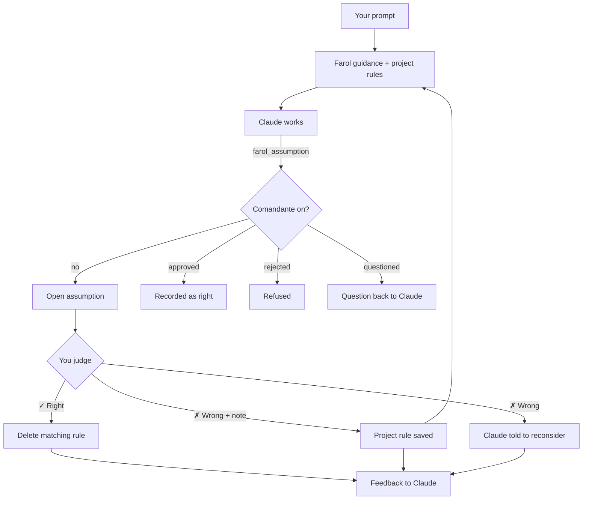

# Farol: assumptions you can correct

Farol collects the assumptions Claude makes without you saying so, lets you mark each one right or wrong, and turns a
correction into a project rule that Claude reads in every later turn.

| | |
| --- | --- |
| Feature id | `farol` |
| Default | On |
| Model | None. Farol asks no model; only the [Comandante](../agents/comandante.md), when on, asks Jev about each assumption. |
| Command | `/farol` opens the Farol pane |
| Code | `registerFarol`, `farolCompose`, `farolJudge`, `farolAbove` in `hooks/register.tsx` |

## When it acts

- **Every prompt:** while Farol is on, Pingo adds guidance that asks Claude to record its assumptions.
- **When Claude records one:** Claude calls the `farol_assumption` tool (seen by Claude as `mcp__jev__farol_assumption`).
- **When you judge one:** in the Farol pane, or from the line above the prompt.

## How it works

1. Pingo registers the `farol_assumption` tool (`assumption`, optional `context`) and the `/farol` command, then loads
   the project's saved rules.
2. Each prompt gets a guidance section. The **Scope** preference picks the text: *All* (default) asks for every
   assumption, *Important* only for those that change the result. Saved rules are added as a second section:
   "Project rules learned from corrected assumptions".
3. When Claude calls the tool, Farol records the assumption as open and answers "Farol recorded assumption #n.
   Continue working." With the Comandante on, a rejected assumption is refused, a questioned one goes back to Claude
   unrecorded, and an approved one is recorded as already right.
4. You mark an assumption **✓ Right** or **✗ Wrong**, optionally with "What should it be instead?".
   - Wrong with a note saves a project rule `{assumption, correction}`.
   - Wrong without a note saves no rule; Claude is told to reconsider it.
   - Right deletes any rule with the same assumption text.
5. Claude learns the verdicts: at once as a new prompt when no turn is running; otherwise with the result of its next
   tool call; or, if a turn ends with a wrong verdict still unsent, through the Stop hook.

## What you see

- **Above the prompt:** "n assumptions to review · Farol", or "n project rules · Farol" when nothing is open. Pressing
  it opens the pane. When the Deck mascot is shown, the mascot says it instead.
- **Farol pane:** the project rules (each with **Delete**), one card per assumption with **✓ Right** (`y`) and
  **✗ Wrong** (`n`), a correction field, and **Clear reviewed**.

## Configuration

| Setting | Where | Default |
| --- | --- | --- |
| Farol on/off | AI screen, or `/jev feature farol on\|off` | On |
| Scope (All / Important) | `assumptionScope`, AI screen | All |

Rules are stored per project (`farol:rules:<project root>`). Open assumptions live only in the session's memory.

## To confirm

- Whether open assumptions survive `/clear` (the session-start handler does not reset them).
