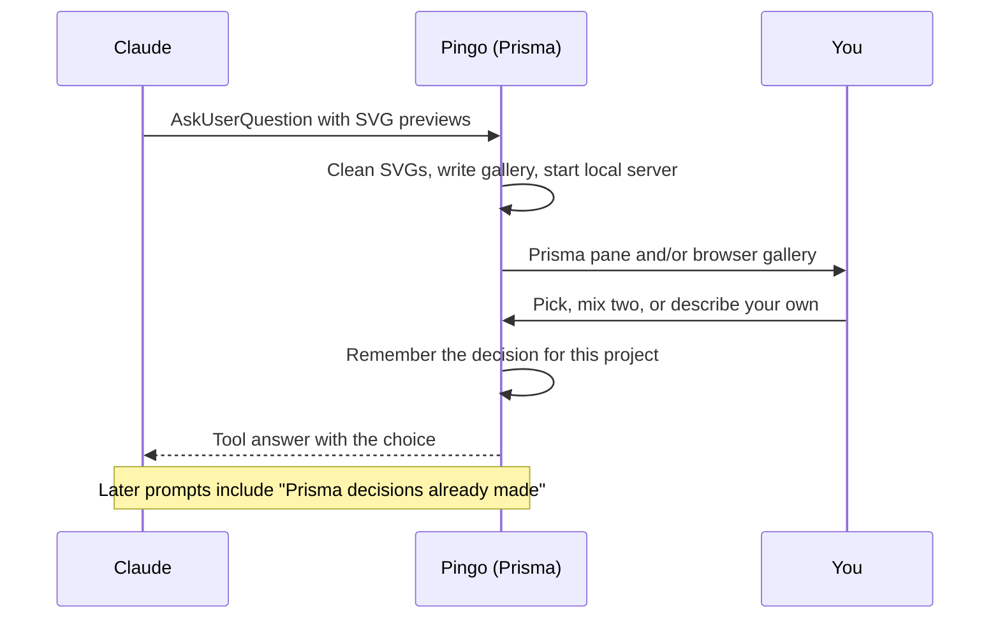

# Prisma: visual design choices

Prisma turns a design question that Claude asks with SVG previews into a visual picker, in a pane and in a local
browser gallery. You can pick one option, mix two, or describe your own. Your choices are remembered per project and
given to Claude in later turns.

| | |
| --- | --- |
| Feature id | `prisma` |
| Default | On |
| Model | None |
| Command | `/prisma-decisions [clear]`: list or clear the project's remembered choices |
| Code | `prismaCompose`, `prismaGallery`, `rememberPrisma`, the `AskUserQuestion` tool hook in `hooks/register.tsx` |

## When it acts

When Claude calls `AskUserQuestion`, Prisma is on, and at least one option has a `preview` that starts with `<svg`.
A plain question without SVG previews keeps Claude Code's normal dialog.

## How it works

1. **Guidance.** When `AskUserQuestion` is available, Claude's context asks it to attach self-contained SVG previews
   (under 8 KB) to design choices. Remembered decisions are always added as "Prisma decisions already made in this
   project".
2. **Interception.** Pingo cleans every SVG (no script, `foreignObject`, event handlers, `href`, `url()` or `@import`),
   writes the previews and an HTML gallery to a temporary folder, and starts a local Python server on `127.0.0.1`
   with a token-protected POST.
3. **Picker.** The pane shows one card per option; the browser gallery shows the same choices. You can pick, mix two
   options of a single-choice question, or type your own answer.
4. **Answer.** The choice goes back to Claude as the tool answer. A mix reads `Mix of "A" and "B": blend both
   directions into one design`.
5. **Memory.** Each answered question is saved (question, choice, chosen descriptions, time). A new answer replaces
   the old one for the same question; the last 50 are kept.
6. **Fallbacks.** If the server cannot start, Claude Code's normal dialog opens without the SVG previews. Closing the
   Prisma pane without an answer refuses the tool call.

## Configuration and commands

| Setting | Key | Default | Values |
| --- | --- | --- | --- |
| Where the choice appears | `designSurface` | `auto` | `auto` (panel and browser), `pane` (panel only), `browser` (browser only) |

| Command | Effect |
| --- | --- |
| `/prisma-decisions` | List the project's remembered choices. |
| `/prisma-decisions clear` | Delete them. |

Decisions are stored per project (`prisma:decisions:<project root>`). The local server needs Python (`python`/`py` on
Windows, `python3`/`python` elsewhere).
