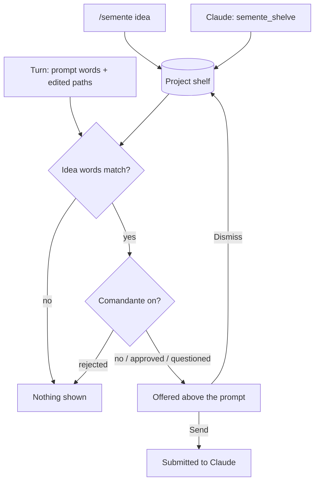

# Semente: a shelf for side ideas

Semente saves side ideas and out-of-scope improvements, from you or from Claude, on a per-project shelf, and offers a
saved idea again when your recent work touches the same subject.

| | |
| --- | --- |
| Feature id | `semente` |
| Default | On |
| Model | None. Matching is by words. Only the [Comandante](../agents/comandante.md), when on, asks Jev. |
| Command | `/semente [idea]`: save an idea; with no text, open the shelf |
| Code | `sementeStart`, `sementeTurnCompleted`, `sementeAbove` in `hooks/register.tsx` |

## When it acts

- **Claude shelves an idea:** through the `semente_shelve` tool (seen by Claude as `mcp__jev__semente_shelve`).
- **You shelve an idea:** with `/semente <idea>` or the pane's "+ New idea…" field.
- **End of each main turn:** it looks for saved ideas that fit the work just done, if **Idea nudges** is on.

## How it works

1. Pingo registers the tool and the command, then loads the project's shelf. Claude's context gets a short guidance
   section whenever the tool is available.
2. Claude's ideas are saved with source "claude" ("Claude saved an idea: …"); yours with source "you".
3. During a turn Semente collects topic words from your prompt and from the last two path parts of every file Claude or
   a subagent edits. Words are split on camelCase, lowercased, at least four letters, minus a stop list.
4. At the end of the turn, an idea fits when any of its words is a topic. Ideas saved in this turn and ideas you
   dismissed are left out.
5. With the Comandante on, each fitting idea is judged first: rejected ideas are not offered; questioned ideas are
   offered with the question.
6. **Send** removes the ideas from the shelf and submits them to Claude as your message ("Ideas to pick up: …").
   **Dismiss** stops offering an idea in this run; it stays on the shelf.

## What you see

- **Above the prompt** (hidden while Claude works): "n saved ideas fit recent work:", the ideas, then **Send** and
  **Dismiss**. When the Deck mascot is shown, the mascot says it instead.
- **Semente pane:** the ideas that fit, a "+ New idea…" field with **Save**, and the whole shelf with **Send** and
  **×** (delete) per idea, plus any Comandante ruling.

## Configuration

| Setting | Key | Default |
| --- | --- | --- |
| Semente on/off | `/jev feature semente on\|off` | On |
| Idea nudges | `ideaNudges` | On |

The shelf is stored per project (`semente:ideas:<project root>`). Dismissals last for the current run only.
