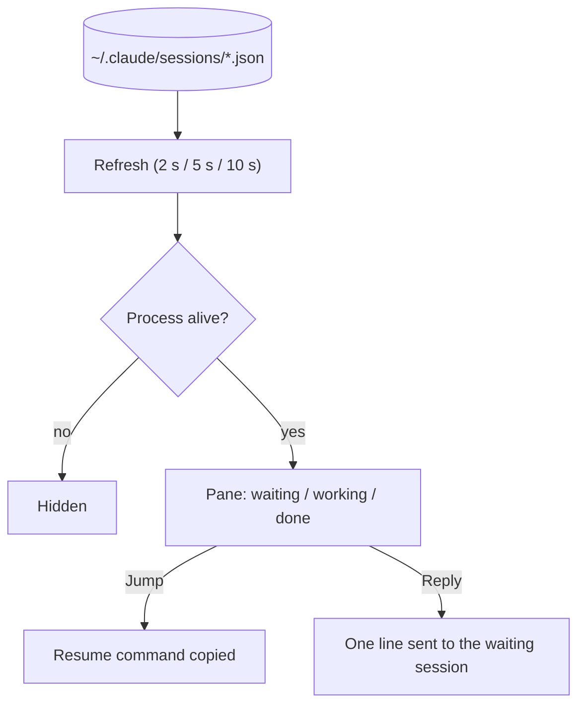

# Sentinela: sessions across projects

Sentinela lists the Claude Code sessions running on this machine, in every project, with their status. From its pane
you can copy the command that resumes a session, or send one line to a session that is waiting for you.

| | |
| --- | --- |
| Feature id | `sentinela` |
| Default | On |
| Model | None |
| Command | `/sentinela` opens or closes the pane |
| Code | `registerSentinela`, `refreshSentinela`, `sentinelaAbove` in `hooks/register.tsx` |

## When it acts

Continuously while the session runs: a 2 s timer refreshes the list whenever the **Refresh** interval has passed.

## How it works

1. Read `~/.claude/sessions/*.json`: process id, session id, name, working folder (the project is its last folder),
   status (waiting, working, done), what it waits for, and when it changed.
2. Keep only sessions whose process is running (`tasklist` on Windows, `ps` elsewhere). The process check repeats only
   when the process ids change or after 30 s.
3. **Jump** copies the resume command: `Set-Location -LiteralPath '<folder>'; claude --resume <id>` on Windows, or
   `cd '<folder>' && claude --resume <id>` elsewhere.
4. **Reply** (on a waiting session other than this one, when the pane accepts text) sends one line with
   `$.session.send`. A toast says whether it was sent.

## What you see

- **Above the prompt:** a **Sessions** button with the waiting, working and done counts. When the Deck mascot is
  shown, it says "n sessions waiting for you" instead.
- **Sentinela pane:** one row per session with **Jump** and, for waiting sessions, **Reply**.

## Configuration

| Setting | Key | Default |
| --- | --- | --- |
| Sentinela on/off (Features screen) | `/jev feature sentinela on\|off` | On |
| Refresh (Features screen) | `monitorEveryMs` | 2 s (2 / 5 / 10 s) |

## To confirm

- Nothing in this repository writes `~/.claude/sessions/*.json`; they are read as Claude Code writes them (inferred).
