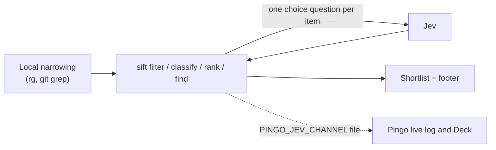

# Sift: semantic search with Jev

Sift is a command-line tool and a Claude skill that asks Jev bounded yes/no, label and relevance questions about many
files, lines or items, and prints a shortlist. It is meant for meaning-based judgments after local tools (`rg`,
`git grep`, scripts) have narrowed the candidates.

| | |
| --- | --- |
| Where | `scripts/sift.ts` (Node 22.18+); skill `skills/sift/SKILL.md` |
| Model | Jev (each question is a SystemOne request; 180 s timeout per call) |
| Routing | Not gated by `/jev routing`; it needs a provider key |
| Code | `scripts/sift.ts`, `hooks/core/sift.ts`, `hooks/core/channel.ts` |

## When to use it

Use `rg` for literal matches and local code for numeric rules. Select bounded candidate files or items first, then
ask semantic questions. Read the selected content before editing or drawing conclusions. Skip Sift for exact matches,
counting, dates, math and small inputs.

## Commands

Here, `sift` means `node scripts/sift.ts` from the checkout. The installed skill calls
`node "${CLAUDE_PLUGIN_ROOT}/scripts/sift.ts"`.

| Command | Use |
| --- | --- |
| `sift filter "<yes/no question>" <inputs>` | Keep semantic matches from files, `--lines`, or `--items` JSONL. |
| `sift classify --labels "a,b,c" <inputs>` | Assign labels and expose uncertain judgments. |
| `sift rank "<query>" <inputs>` | Rank bounded candidates by relevance. |
| `sift find "<what>" <files>` | Find relevant lines in clipped chunks. |
| `sift ask "<question>" --state @file` | Ask yes/no or `--choice` questions, or supply a raw spec. |
| `sift status` | Test provider/model and show lifetime counters. |

```sh
node scripts/sift.ts --help
node scripts/sift.ts filter "Does this file handle authentication?" hooks --ext ts,tsx
node scripts/sift.ts classify --labels "bug,feature,question" --items tickets.jsonl
node scripts/sift.ts rank "agent model selection" hooks --top 5 --save ranked.json
```

Inputs accept files, directories, globs, stdin (`-`), and JSONL `{ "id": "T1", "text": "..." }` items. Discovery
respects Git ignores. Item, concurrency, character and chunk limits are explicit options. `--json` prints
machine-readable stdout with diagnostics on stderr; `--save FILE` keeps the results. Uncertain judgments and failed
items stay visible.

## How it works

1. Sift collects the inputs, refusing credential-like files, binaries, files over 2 MB, lockfiles and dependency
   folders.
2. It sends Jev one request per item or chunk, with the question as a choice question.
3. It prints the matches, labels or ranking, with uncertain items marked, and a footer with counts and token use.
4. When Claude runs Sift inside a session, Pingo sets `PINGO_JEV_CHANNEL`; Sift appends each Jev event to a channel
   file, and Pingo follows it so Sift's calls appear in the live log and on the Deck.



## What the footer means

The footer's content-minus-output figure estimates **potential context avoided**. It does not measure actual Claude
input, later work, cache reuse or net savings. Jev tokens are counted separately. For example, about 10,000 tokens of
candidates and 1,000 tokens of output imply 9,000 tokens of potential context avoided; a separately reported 2,000
Jev input tokens do not turn that into a measured net gain. Total-benefit claims need a controlled whole-task
comparison: see the [benchmark reproduction](../../bench/README.md) and the [evaluation protocol](../../bench/protocol.md).

Explicit Sift commands send the judged content and criteria to the selected Jev provider. Results are persisted only
with `--save`.
